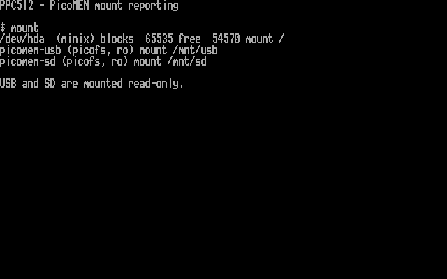
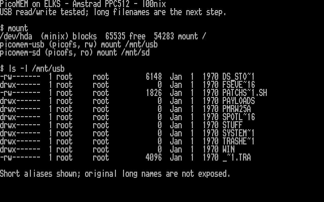
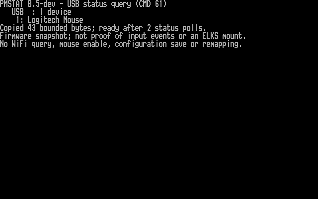
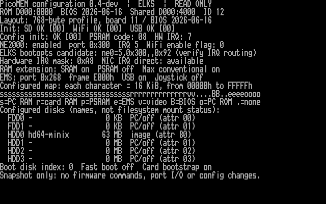
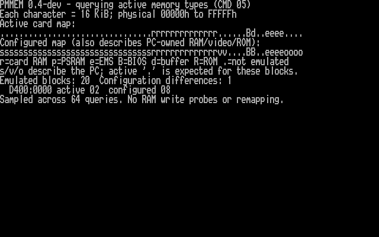

> ⚠️ I’m developing this project with AI assistance out of personal interest. It may not fully align with the ELKS maintainer team’s architectural or development guidelines. Please use it at your own discretion. ⚠️

# PicoMEM tools for ELKS Linux

I'm developing `pmconfig`, a native 8086 PicoMEM configuration utility for ELKS,
with small companion commands for support dumps, status and memory inspection.
I test it on an Amstrad PPC512. This is an independent experimental project.

My work builds on the published interfaces and examples from
[FreddyV’s PicoMEM project](https://github.com/FreddyVRetro/ISA-PicoMEM) and
[jdredd87’s PicoMEM tools](https://github.com/jdredd87/CH375USBTools/tree/main/PicoMEM).
I implemented the ELKS utilities separately in C using those projects as references.

## Native USB block-device review — Beta 1 candidate

The latest experimental implementation uses a PicoMEM subdriver behind ELKS's
existing SSD block driver. Native ELKS MINIX/FAT code and the normal buffer
cache, `mount`, `sync` and `umount` handle files. PicoMEM transfers sectors
through its existing command/data ports.

**[Current source, patch separation, test evidence and limits](review/ssd-beta1-20261115/README.md).**
[Published upstream review updates](docs/USB-BETA1-UPSTREAM-20261115.md).
This supersedes the [8 November partition-aware snapshot](review/native-block-20261108/README.md).
The current candidate exposes one directly attached USB device with 512-byte
sectors as **`/dev/ssd`**. It currently supports FAT volumes whose boot sector is at device LBA 0
(superfloppy layout), and sector-zero MINIX filesystems;
it does not map MBR partitions to `/dev/ssd1`. This is an implementation
limitation: an arbitrary FAT-formatted USB stick must not be assumed compatible.
Reuse of existing ELKS code for MBR support is a separate maintainer-review question. The paired kernel and firmware
are required; the older downloads below do not provide this implementation.

Native MINIX, FAT16 and FAT32 writes have been exercised on test fixtures.
Orderly USB removal/reinsertion and drive changes work after successful
unmount and closing raw-device handles. Removal while mounted and recovery
from uncertain transfers are outside this support: faults require a full
power cycle. Internal SD image boot remains on the existing BIOS path; this
candidate adds no native access to the SD card's outer filesystem.

The review separates the SSD backend, orderly-hotplug extension, native FAT
corrections, raw-device bounds check, optional `fdisk` probe, and unrelated
Amstrad display shortcut. PicoMEM firmware and a pinned TinyUSB MSC completion
patch are separate dependencies. Long-filename creation/rename work remains
deferred.

Current hotplug evidence covers REDX20's 8 MiB flat FAT16 fixture and PMBLUE's
48 MiB flat FAT32 fixture, including independent file, FAT-table, allocation
and guard checks. Earlier MINIX and Windows–ELKS checks are identified by
their tested revisions in the review packet. These fixture sizes are not the
physical drive capacities.

**This is an experimental review candidate, not an upstream-approved release.**
One FAT32 run lost its network response; a separately recorded continuation
and independent media checks passed, but the interruption remains unexplained.
A read-only `df` took 179 seconds on PMBLUE. General responsiveness, broader
media compatibility and power-loss behavior remain limitations.

The optional `fdisk -l` change only probes `/dev/ssd` after the existing `/dev/hda` listing.
Its stock table renderer is unchanged: on a flat filesystem it may print empty
or meaningless partition rows. Those rows do not establish usable partitions.

The utility documentation below remains available. **Earlier `picofs`/`pmmount`
instructions, nine-media/DOS results and the 8 November source snapshot describe
superseded implementations.** Do not mix their binaries or qualification results
with this candidate.

## Commands and Usage

| Command | Current function |
| --- | --- |
| `pmconfig` | Configuration summary; `--details` adds PMINFO-style board/BIOS information, ROMs, audio, clocks, RTC and image directories. `-v` adds raw configuration bytes. |
| `pmdump NEWFILE` | A bounded, CRC-checked 964-byte support file, created privately and verified by reading it back. Excludes command parameters and WiFi keys. |
| `pmstat` | Passive summary by default; `--usb` queries cached USB inventory and `--disks` queries firmware disk/image geometry metadata. |
| `pmmem` | Queries the card's active memory types and compares them with the configured map. `--probe` checks just the BIOS block first. No RAM write probes or remapping. |
| `pmmount` (earlier picofs builds) | Mounts PicoMEM USB or SD read-only; `--rw usb` explicitly enables experimental USB writes; `-u` unmounts. Requires the optional PicoMEM kernel. |
| `mount` (earlier picofs builds) | Lists mounted filesystems, including PicoMEM USB/SD mountpoints and their `ro`/`rw` status. Supplied with the kernel build. |

`pmconfig`, `pmdump`, `pmstat` and `pmmem` select modes of one executable.
`pmmount` and the updated `mount` are separate utilities for the earlier picofs kernel builds; the current SSD candidate uses normal ELKS mount commands.
`pmcfg` remains a compatible name
for the configuration mode. I adopted `pmconfig` as the clearer primary name;
all command names fit eight characters.

### Earlier picofs USB and SD mounts

This section documents the earlier file-service builds. For the current native
block-device design, use the [review snapshot](review/ssd-beta1-20261115/README.md).

I have tested **USB read/write and SD read-only mounts on the PPC512** using
the optional `picofs` kernel filesystem. Ordinary ELKS commands such as `ls`,
`cat` and `cp` can access the mounted files. SD access exposes the PicoMEM
card's outer filesystem, separate from the ELKS Minix root inside its disk image.

**This requires the modified ELKS kernel, `pmmount` and the matching updated
`mount` utility. Installing `pmconfig` alone does not add filesystem support.**
The [tested USB-write build](dist/kernel-usb-rw-20261025/README.md) includes
these binaries and their checksums. The [kernel build kit](kernel/README.md)
provides the source, pinned ELKS revision, remote compilation and detailed
installation notes.

After booting that kernel and installing the utilities, run as root. Start
with both mountpoints unmounted:

```sh
mkdir -p /mnt/usb /mnt/sd
pmmount usb /mnt/usb
pmmount sd /mnt/sd
mount
ls -l /mnt/usb
ls -l /mnt/sd
```

`pmmount` defaults to read-only. This PPC512 console capture shows the updated
`mount` command listing both volumes as `picofs, ro`:



To enable experimental USB writes, leave the mounted directories, close files
in use there and unmount USB before mounting it read/write:

```sh
cd /
pmmount -u /mnt/usb
pmmount --rw usb /mnt/usb
mount
ls -l /mnt/usb
```

The later PPC512 capture shows **USB as `rw` and SD as `ro`**, followed by a
USB directory listing. Original long filenames are not yet exposed; the
firmware currently supplies 8.3 aliases:



I verified USB creation, append, overwrite, truncate-to-empty, deletion and
directory operations, with independent file readback after remount and normal
reboot. SD writes remain disabled. Use backed-up test media for USB writes;
the firmware interface does not provide a verified power-loss flush guarantee.
Do not remove media while mounted. Unmount from outside both directories after
closing files in use:

```sh
cd /
pmmount -u /mnt/usb
pmmount -u /mnt/sd
mount
```

The optional mouse driver also requires both volumes to be unmounted; actual
mouse movement/buttons remain unvalidated. These screenshots are hardware
text-screen captures rendered with the PPC's BIOS font.

[Mount-listing hardware results](docs/HARDWARE-MOUNT-20261025.md) ·
[USB-write results](docs/HARDWARE-USB-RW-20261025.md) ·
[Filesystem limits and build instructions](kernel/README.md) ·
[Long-filename proposal](docs/LONG-FILENAMES.md)

### Screenshots from the PPC512



Firmware detection alone does not provide ELKS mouse input. I developed an
[optional experimental kernel mouse driver](mouse/README.md), with a separate
30-second capture program; mouse testing is currently paused. See the
[integration audit](docs/ELKS-MOUSE.md).

The separate experimental [`pmusb`](usb/README.md) now lists USB root-directory
entries directly from native ELKS through PicoMEM's file service. I tested it
with a Kingston DataTravelerMini on the PPC512 after a cold power cycle. It
provides bounded, read-only metadata access only. For file-content access and
ELKS mounts, use the separate [kernel filesystem integration](#mounting-usb-and-sd-in-elks)
described above. [Earlier pmusb hardware results and screenshot](docs/HARDWARE-USB-FLASH-20261023.md).

The complete decoded configuration report is captured across
[three console pages](docs/HARDWARE-TEST-20261023.md#screenshots).
[Full native text, including all 768 configuration bytes](docs/examples/pmconfig-all-20261023.txt)
is also available.





These are actual hardware video-memory captures rendered using the PPC's BIOS
font. The longer native report was displayed in pages before capture.
[Provenance, additional screenshots and interpretation](docs/HARDWARE-TEST-20261023.md).

Earlier v0.2 testing changed the NIC from IRQ3 to IRQ5, matched ELKS `/bootopts`,
rebooted and verified DHCP plus HTTP. The original
[staged IRQ screenshot](docs/screenshots/staged-irq-ppc512.png),
[working networking screenshot](docs/screenshots/network-ppc512.png) and
[test record](docs/HARDWARE-TEST.md) remain available.

### Install and use

Download [dist/pmconfig](dist/pmconfig), the tested **21,088-byte ELKS/i8086**
executable. It is not a DOS or modern Linux executable.
[Checksums and build provenance](dist/README.md).

After transferring it to the ELKS machine, install as root:

```sh
cp pmconfig /bin/pmconfig
chmod 755 /bin/pmconfig
ln /bin/pmconfig /bin/pmdump
ln /bin/pmconfig /bin/pmstat
ln /bin/pmconfig /bin/pmmem
```

If the filesystem does not support hard links, use copies under those names.
Keep an existing known-good `pmcfg` while trying the development build. The
original v0.2 [dist/pmcfg](dist/pmcfg) is preserved unchanged.

```sh
pmconfig
pmconfig --details
pmconfig --details -v
pmstat
pmstat --usb
pmstat --disks
pmdump support.dmp
pmmem --probe
pmmem
```

Equivalent modes without companion names are `pmconfig --status`,
`pmconfig --dump support.dmp` and `pmconfig --memory`.
`pmmem` requires root, the supported profile and an idle command interface;
it stops on a failed query without an automatic retry.

Copy a support file back to a host and validate it with:

```sh
python3 tools/read-dump.py support.dmp
```

Support files may contain personal image names or paths; inspect before sharing.
They are troubleshooting snapshots, **not restore files or copies of the SD
card's `PICOMEM.CFG`**. [Format and query design](docs/TOOLS.md).

### Next-boot configuration changes

Only `nic-irq=3|5|7` and `fast-boot=on|off` are editable. IRQ choices must also
appear in the detected hardware IRQ mask. These settings take effect after a
reboot; the utility does not reconfigure running devices live.

Stage and review first:

```sh
pmconfig --stage nic5.pmc nic-irq=5
pmconfig --show nic5.pmc
```

Explicitly save with a new backup filename:

```sh
pmconfig --save nic5.pmc --backup before.pmc
```

Stage and backup files are never overwritten. Save refuses stale snapshots,
unsupported profiles and unavailable IRQs. The backup must be written, read
back and synced before the hardware transaction.

For the tested NIC at `0x300`, IRQ5 requires `ne0=5,0x300,,0x92` in ELKS
`/bootopts`. Check IRQ conflicts, preserve the old boot options, stop networking
before switching IRQs, and arrange serial/local access for the reboot.
`pmconfig` does not edit `/bootopts` or reboot automatically.

To stage a rollback, review it and then save separately:

```sh
pmconfig --restore before.pmc --stage undo.pmc
pmconfig --show undo.pmc
pmconfig --save undo.pmc --backup undo-old.pmc
```

Restore the matching ELKS NIC boot option before rebooting.

## Current limits

- Firmware acknowledgment and warm-reboot behavior were tested with v0.2.
  SD-file readback and full power-cycle persistence verification remain pending.
  The 0.4/0.5 hardware rounds exercised inspection, queries and staging; they
  did not repeat a configuration save or reboot.
- A save timeout can leave uncertain persistent state. Preserve the backup and
  investigate before rebooting; the program does not retry automatically.
- Disk images, memory mappings, WiFi credentials, audio and I/O ports remain
  non-editable. `pmmem` provides evidence for future 512/640 KB profiles; it does
  not switch profiles or test RAM contents.
- `pmstat` reports sampled initialization/configuration, not proof of a current
  connection or mounted USB device. Explicit `--usb`/`--disks` queries return
  bounded firmware snapshots; detection alone does not prove mouse events
  reach ELKS. No WiFi query or mouse-enable command is issued.
- The BIOS date/ROM check is a compatibility guard, not cryptographic firmware
  identification. Modified firmware with the same date may behave differently.

[Configuration/save design](docs/DESIGN.md) · [Other tools and porting priorities](docs/PORTING.md)

## Build and test

Supply a prepared ELKS tree containing its IA16 toolchain and libc:

```sh
TOPDIR=/absolute/path/to/elks sh build.sh
make test
```

`build.sh` produces `build/pmconfig` and copies named `pmcfg`, `pmdump`, `pmstat`
and `pmmem`. The native build used ia16-elf-gcc 6.3.0, the 8086 small memory
model and an ELKS `e1469b64` toolchain/libc tree. Host tests need Python 3 and a
C99 compiler. All **114 tests/scenarios** pass: 21 viewer, 14 staging, 10 support
and dispatch, 9 save-transaction, 14 snapshot, 18 memory-query and 28 status-query
cases. Fake hardware
backends cannot send commands to a real PicoMEM. Native critical sections were
also inspected for compiler-inserted calls. External `buildext.sh` integration
remains a follow-up; this repository currently supplies the standalone build.

## Earlier development status — 3 November 2026 (superseded architecture)

I have tested an experimental paired firmware/kernel candidate for USB reads,
writes, creation, append, truncation, deletion and same-directory file rename
with ASCII long names up to 26 bytes on the PPC512. Nine media completed guarded
ELKS–Mac–ELKS data checks, covering FAT16 and FAT32; DOS 8.3 compatibility also
passed on a USB-to-SD adapter/card. Internal PicoMEM SD mounts remain read-only.

**This is not a released long-filename build.** The source and downloads on
`main` still describe the earlier short-name implementation. The newer candidate
requires matching development firmware, kernel and utilities. An intermittent
USB read failure and a separate FTP greeting timeout remain unresolved.
Upstream feedback has arrived. I am preparing focused validation for nested
directories, kernel-stack use, resource reuse and mount lifecycle before
packaging the candidate for review. These additional checks are not yet complete.

[Current results, media matrix and limitations](docs/STATUS-20261102.md) ·
[Published upstream updates](docs/UPSTREAM-UPDATES-20261102.md)

## Earlier utility and mount builds

**The 0.5 development build detects the PPC512's wireless USB receiver as
Logitech Mouse.** `pmstat --usb` and `pmstat --disks` now query bounded firmware
status responses. Repeated queries completed successfully, configuration stayed
unchanged, and an HTTP transfer passed its checksum afterward.
[New hardware results and screenshots](docs/HARDWARE-USB-20261023.md).

The earlier 0.4 round validated expanded inspection, support dumps and all
64 active memory-map queries. [Earlier results and six screenshots](docs/HARDWARE-TEST-20261023.md).

The supported extended/configuration profile is **PicoMEM 2, board ID 11,
BIOS 2026-06-16**. Other profiles get the common inspection prefix only.

The optional [kernel filesystem integration](kernel/README.md) already mounts
USB and SD read-only. I have added experimental, opt-in USB writes while keeping SD read-only. See
[Mounting USB and SD in ELKS](#mounting-usb-and-sd-in-elks) for commands and screenshots. The
[new build](dist/kernel-usb-rw-20261025/README.md) has passed host, emulator and
PPC512 write tests, including independent readback after remount and normal
reboot. [Hardware results and screenshot](docs/HARDWARE-USB-RW-20261025.md).
These published binaries use short names. Long-name read/write testing is
covered by the separate [development status](docs/STATUS-20261102.md).

I published this source snapshot under `l00nix`, with fresh public commit history.
The project credits, GPL license, tested binaries and hardware evidence are
included. The [long-filename audit](docs/LONG-FILENAMES.md) records the original design;
[current development and upstream feedback](docs/STATUS-20261102.md) are tracked separately.

## Relationship, credits and license

I implemented this separately in C for ELKS, using
[FreddyVRetro's PicoMEM firmware](https://github.com/FreddyVRetro/ISA-PicoMEM) and
[jdredd87's DOS PicoMEM tools](https://github.com/jdredd87/CH375USBTools/tree/main/PicoMEM)
as references. It is not a fork or direct Pascal-to-C port, and feature coverage
is different. The DOS PMCFG is read-only; guarded next-boot editing is an
addition in this ELKS implementation.

Thanks to those projects and the [ELKS community](https://github.com/ghaerr/elks).
I'm [l00nix](https://github.com/l00nix), and I develop and test this utility with
AI coding assistance. Source references are recorded in
[DESIGN.md](docs/DESIGN.md) and [PORTING.md](docs/PORTING.md).

Licensed under **GPL-2.0-or-later**; see [COPYING](COPYING).


