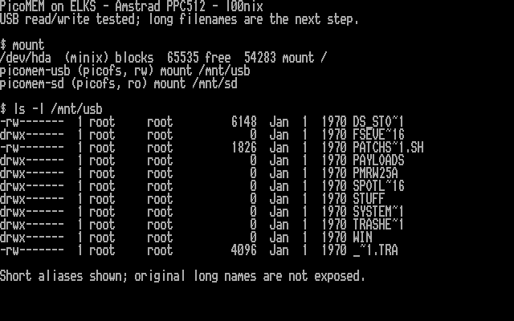
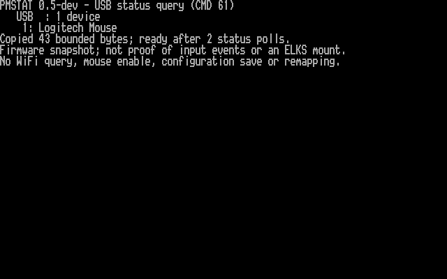

# PicoMEM tools for ELKS Linux

I'm developing `pmconfig`, a native 8086 PicoMEM configuration utility for ELKS,
with small companion commands for support dumps, status and memory inspection.
I test it on an Amstrad PPC512. This is an independent experimental project.

**The 0.5 development build detects the PPC512's wireless USB receiver as
Logitech Mouse.** `pmstat --usb` and `pmstat --disks` now query bounded firmware
status responses. Repeated queries completed successfully, configuration stayed
unchanged, and an HTTP transfer passed its checksum afterward.
[New hardware results and screenshots](docs/HARDWARE-USB-20261023.md).

The earlier 0.4 round validated expanded inspection, support dumps and all
64 active memory-map queries. [Earlier results and six screenshots](docs/HARDWARE-TEST-20261023.md).

The supported extended/configuration profile is **PicoMEM 2, board ID 11,
BIOS 2026-06-16**. Other profiles get the common inspection prefix only.

The optional [kernel filesystem integration](kernel/README.md) already mounts
USB and SD read-only. I have added experimental, opt-in USB writes while keeping SD read-only. The
[new build](dist/kernel-usb-rw-20261025/README.md) has passed host, emulator and
PPC512 write tests, including independent readback after remount and normal
reboot. [Hardware results and screenshot](docs/HARDWARE-USB-RW-20261025.md).
Long filenames remain pending.



I published this source snapshot under `l00nix`, with fresh public commit history.
The project credits, GPL license, tested binaries and hardware evidence are
included. The [long-filename proposal](docs/LONG-FILENAMES.md) describes the
firmware extension I would like to discuss with FreddyV.

## Commands

| Command | Current function |
| --- | --- |
| `pmconfig` | Configuration summary; `--details` adds PMINFO-style board/BIOS information, ROMs, audio, clocks, RTC and image directories. `-v` adds raw configuration bytes. |
| `pmdump NEWFILE` | A bounded, CRC-checked 964-byte support file, created privately and verified by reading it back. Excludes command parameters and WiFi keys. |
| `pmstat` | Passive summary by default; `--usb` queries cached USB inventory and `--disks` queries firmware disk/image geometry metadata. |
| `pmmem` | Queries the card's active memory types and compares them with the configured map. `--probe` checks just the BIOS block first. No RAM write probes or remapping. |

These names select modes of one executable. `pmcfg` remains a compatible name
for the configuration mode. I adopted `pmconfig` as the clearer primary name;
all command names fit eight characters.

## Screenshots from the PPC512



Firmware detection alone does not provide ELKS mouse input. I developed an
[optional experimental kernel mouse driver](mouse/README.md), with a separate
30-second capture program; mouse testing is currently paused. See the
[integration audit](docs/ELKS-MOUSE.md).

The separate experimental [`pmusb`](usb/README.md) now lists USB root-directory
entries directly from native ELKS through PicoMEM's file service. I tested it
with a Kingston DataTravelerMini on the PPC512 after a cold power cycle. It
provides bounded, read-only metadata access; file-content reads and an ELKS
mount are not implemented. [Hardware results and screenshot](docs/HARDWARE-USB-FLASH-20261023.md).

The complete decoded configuration report is captured across
[three console pages](docs/HARDWARE-TEST-20261023.md#screenshots).
[Full native text, including all 768 configuration bytes](docs/examples/pmconfig-all-20261023.txt)
is also available.


These are actual hardware video-memory captures rendered using the PPC's BIOS
font. The longer native report was displayed in pages before capture.
[Provenance, additional screenshots and interpretation](docs/HARDWARE-TEST-20261023.md).

Earlier v0.2 testing changed the NIC from IRQ3 to IRQ5, matched ELKS `/bootopts`,
rebooted and verified DHCP plus HTTP. The original
[staged IRQ screenshot](docs/screenshots/staged-irq-ppc512.png),
[working networking screenshot](docs/screenshots/network-ppc512.png) and
[test record](docs/HARDWARE-TEST.md) remain available.

## Install and use

Download [dist/pmconfig](dist/pmconfig), the tested **21,088-byte ELKS/i8086**
executable. It is not a DOS or modern Linux executable.
[Checksums and build provenance](dist/README.md).

After transferring it to the ELKS machine, install as root:

```sh
cp pmconfig /bin/pmconfig
chmod 755 /bin/pmconfig
ln /bin/pmconfig /bin/pmdump
ln /bin/pmconfig /bin/pmstat
ln /bin/pmconfig /bin/pmmem
```

If the filesystem does not support hard links, use copies under those names.
Keep an existing known-good `pmcfg` while trying the development build. The
original v0.2 [dist/pmcfg](dist/pmcfg) is preserved unchanged.

```sh
pmconfig
pmconfig --details
pmconfig --details -v
pmstat
pmstat --usb
pmstat --disks
pmdump support.dmp
pmmem --probe
pmmem
```

Equivalent modes without companion names are `pmconfig --status`,
`pmconfig --dump support.dmp` and `pmconfig --memory`.
`pmmem` requires root, the supported profile and an idle command interface;
it stops on a failed query without an automatic retry.

Copy a support file back to a host and validate it with:

```sh
python3 tools/read-dump.py support.dmp
```

Support files may contain personal image names or paths; inspect before sharing.
They are troubleshooting snapshots, **not restore files or copies of the SD
card's `PICOMEM.CFG`**. [Format and query design](docs/TOOLS.md).

## Next-boot configuration changes

Only `nic-irq=3|5|7` and `fast-boot=on|off` are editable. IRQ choices must also
appear in the detected hardware IRQ mask. These settings take effect after a
reboot; the utility does not reconfigure running devices live.

Stage and review first:

```sh
pmconfig --stage nic5.pmc nic-irq=5
pmconfig --show nic5.pmc
```

Explicitly save with a new backup filename:

```sh
pmconfig --save nic5.pmc --backup before.pmc
```

Stage and backup files are never overwritten. Save refuses stale snapshots,
unsupported profiles and unavailable IRQs. The backup must be written, read
back and synced before the hardware transaction.

For the tested NIC at `0x300`, IRQ5 requires `ne0=5,0x300,,0x92` in ELKS
`/bootopts`. Check IRQ conflicts, preserve the old boot options, stop networking
before switching IRQs, and arrange serial/local access for the reboot.
`pmconfig` does not edit `/bootopts` or reboot automatically.

To stage a rollback, review it and then save separately:

```sh
pmconfig --restore before.pmc --stage undo.pmc
pmconfig --show undo.pmc
pmconfig --save undo.pmc --backup undo-old.pmc
```

Restore the matching ELKS NIC boot option before rebooting.

## Current limits

- Firmware acknowledgment and warm-reboot behavior were tested with v0.2.
  SD-file readback and full power-cycle persistence verification remain pending.
  The 0.4/0.5 hardware rounds exercised inspection, queries and staging; they
  did not repeat a configuration save or reboot.
- A save timeout can leave uncertain persistent state. Preserve the backup and
  investigate before rebooting; the program does not retry automatically.
- Disk images, memory mappings, WiFi credentials, audio and I/O ports remain
  non-editable. `pmmem` provides evidence for future 512/640 KB profiles; it does
  not switch profiles or test RAM contents.
- `pmstat` reports sampled initialization/configuration, not proof of a current
  connection or mounted USB device. Explicit `--usb`/`--disks` queries return
  bounded firmware snapshots; detection alone does not prove mouse events
  reach ELKS. No WiFi query or mouse-enable command is issued.
- The BIOS date/ROM check is a compatibility guard, not cryptographic firmware
  identification. Modified firmware with the same date may behave differently.

[Configuration/save design](docs/DESIGN.md) · [Other tools and porting priorities](docs/PORTING.md)

## Experimental kernel integration

I have tested the optional kernel on the PPC512 with **read-only USB and SD
mounts**, directory browsing, file reads/copies, seek/EOF and write-open
rejection. The [kernel build kit](kernel/README.md) pins the ELKS revision and
supports remote compilation. It also includes the optional mouse driver;
passive checks pass, but actual movement/buttons remain unvalidated. Unmount
both volumes before using the mouse driver.

[Hardware results and screenshots](docs/HARDWARE-KERNEL-FS-20261023.md) ·
[Tested experimental binaries](dist/kernel-20261023/README.md).

## Build and test

Supply a prepared ELKS tree containing its IA16 toolchain and libc:

```sh
TOPDIR=/absolute/path/to/elks sh build.sh
make test
```

`build.sh` produces `build/pmconfig` and copies named `pmcfg`, `pmdump`, `pmstat`
and `pmmem`. The native build used ia16-elf-gcc 6.3.0, the 8086 small memory
model and an ELKS `e1469b64` toolchain/libc tree. Host tests need Python 3 and a
C99 compiler. All **114 tests/scenarios** pass: 21 viewer, 14 staging, 10 support
and dispatch, 9 save-transaction, 14 snapshot, 18 memory-query and 28 status-query
cases. Fake hardware
backends cannot send commands to a real PicoMEM. Native critical sections were
also inspected for compiler-inserted calls. External `buildext.sh` integration
remains a follow-up; this repository currently supplies the standalone build.

## Relationship, credits and license

I implemented this separately in C for ELKS, using
[FreddyVRetro's PicoMEM firmware](https://github.com/FreddyVRetro/ISA-PicoMEM) and
[jdredd87's DOS PicoMEM tools](https://github.com/jdredd87/CH375USBTools/tree/main/PicoMEM)
as references. It is not a fork or direct Pascal-to-C port, and feature coverage
is different. The DOS PMCFG is read-only; guarded next-boot editing is an
addition in this ELKS implementation.

Thanks to those projects and the [ELKS community](https://github.com/ghaerr/elks).
I'm [l00nix](https://github.com/l00nix), and I develop and test this utility with
AI coding assistance. Source references are recorded in
[DESIGN.md](docs/DESIGN.md) and [PORTING.md](docs/PORTING.md).

Licensed under **GPL-2.0-or-later**; see [COPYING](COPYING).

The kernel integration now also builds an updated `mount` utility to display
PicoMEM USB/SD mountpoints and read-only status. See the
[installation and reporting notes](kernel/README.md#mounting-and-accessing-files).

[25 October mount-reporting candidate and validation](dist/kernel-20261025/README.md)
(installed and hardware-tested on the PPC512).
[Mount listing hardware results and screenshot](docs/HARDWARE-MOUNT-20261025.md).
