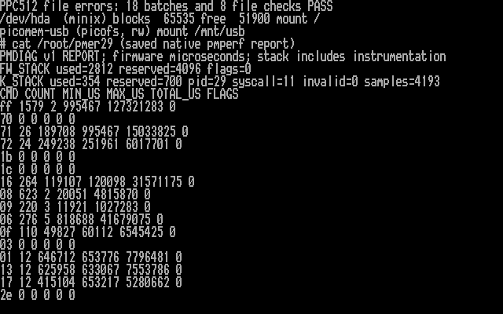

# File-service error candidate

I have tested this firmware-only correctness update after the successful
[runtime diagnostics tests](RUNTIME-DIAGNOSTICS.md). **All 18 PPC512 workload
batches and eight full-file checks after remount passed.** Direct Mac filename/content checks and a read-only FAT check passed too.
The return trip to ELKS also passed; DOS compatibility for this firmware remains pending. This is another
step toward a USB read/write release candidate, not a release announcement.

The preceding firmware can hide both a failed file close and a failed USB sector
transfer. Independent readback catches many problems, but cannot make those
success responses reliable. The new default-off firmware option:

* Reports real close errors and refuses malformed close requests.
* Keeps failed file handles unavailable, so retrying a close cannot mask the
  original failure or reuse an uncertain handle.
* Checks metadata lookup after open and cleans up a failed open operation.
* Reports USB submission/completion errors and the existing transfer timeout.
  USB I/O stays stopped after a transfer failure until PicoMEM firmware restarts.

The existing ELKS kernel already rejects these CLOSE error responses, stops
further file-service operations after an uncertain write, and does not advance
the file position or cached size. I added tests for five DOS error codes to
verify this; no production kernel code or utility binary changed. The existing
full-byte readback checks remain enabled. SD remains read-only.

The USB error latch also affects DOS USB disk-image access because that uses the
same firmware sector adapter. That makes a fresh DOS compatibility test part of
this candidate's validation, even though no DOS long-filename extension is needed.

## PPC512 results — October 29, 2026

I saved and verified a full-flash recovery backup, then flashed and readback-verified
this candidate. The existing kernel and utilities matched their tested hashes;
no kernel installation was needed. The Kingston mounted read/write normally.
Seven prior fixtures matched their expected bytes before the new workload.

All 18 batches in fresh `PMERR29` passed: no-op, read, write, rename pairs,
long-name create/delete and directory create/remove. All eight retained files,
including the new 3073-byte payload, matched their full contents before and
after clean unmount/remount. SD stayed unmounted. USB was subsequently unmounted
successfully for the independent Mac check, which subsequently passed.

| Observation | Used | Reserved |
| --- | ---: | ---: |
| Firmware core-0 stack, workload | 2812 bytes | 4096 bytes |
| ELKS syscall stack, workload and immediate remount report | 354 bytes | 700 bytes |
| ELKS syscall stack, initial pre-reset observation | 426 bytes | 700 bytes |

The firmware workload peak leaves 1284 bytes. All diagnostic flags and invalid
sample counts were zero. These are observed peaks with instrumentation, not
worst-case bounds. The report counted 1579 commands totaling 127.321283 seconds,
including fixture setup and inter-batch verification. No performance improvement
is claimed. This run exercises normal successful I/O; failure handling was tested
only in the host fault-injection tests.

The screenshot is rendered from actual PPC text video memory and its BIOS font.
It shows native `mount` output before the final unmount and the saved native
`pmperf` report immediately after the workload. Its summary reflects the later
post-remount file checks; the command counters remain those of the saved report.

[Raw native report](validation/pmperf-file-errors-20261029.txt) and
[full timings, artifact hashes, stack readings and file checks](validation/file-errors-ppc512-20261029.json).

## Independent Mac check — October 29, 2026

The Mac identified the same physical Kingston and FAT32 volume. I checked the
exact spelling of every path component and read all eight files directly;
every byte count and SHA-256 matched the ELKS readbacks. The new `PMERR29`
directory contained only its expected `Runtime File Alpha.txt` payload.

After a normal unmount, `diskutil verifyVolume` ran `fsck_msdos -n` and reported
filesystem check exit code 0. No repair was requested. The Kingston was safely
ejected for return to PicoMEM. [Read-only FAT check log](validation/file-errors-mac-fat-20261029.txt).
After reconnection to PicoMEM with ELKS still running, the Kingston remounted
read/write and all eight files again matched their exact contents. `ls` displayed
the long filename correctly. The later diagnostic observation was 2812/4096
firmware stack bytes and 402/700 ELKS stack bytes, with no flags or invalid
samples; this is separate from the frozen workload report above. DOS compatibility
remains pending for this firmware.

## Evidence and limits

Five disposable FAT32-image scenarios exercise the real firmware dispatcher,
handle table and FatFs: normal close/remount/readback, write failure, flush
failure, metadata failure after open, and failed cleanup. The normal result also
passes independent `mcopy` readback. Fourteen transport-model cases exercise the
actual USB disk adapter, including rejected transfers, SCSI errors, short
completion, timeout across timer wrap, disconnect, and late completion. The
ELKS host suite and existing firmware LFN/create/rename/diagnostics tests pass.

The ARM build and 4 KiB stack-layout check pass. Turning the new option off
reproduces the previous diagnostics firmware byte-for-byte.
[Candidate artifact hashes and validation](validation/file-errors-preflight-20261029.json).

This preserves `f_close`/`f_sync`; it does not remove flushes to improve timing.
USB `CTRL_SYNC` checks current fault/readiness state but does not send SCSI
SYNCHRONIZE CACHE. A timeout still does not cancel an outstanding TinyUSB transfer;
late-transfer buffer ownership and transport recovery need further engineering.
Power-loss persistence is not established. Reported errors do not undo previous
writes. Failure injection is confined to disposable host images, not the Kingston.

The [firmware implementation and recovery limits](https://github.com/l00nix/ISA-PicoMEM/blob/codex/file-service-errors/FILE-SERVICE-ERRORS.md)
include build instructions. Build with `PICOMEM_EXPERIMENTAL_FILE_ERRORS=ON`
in addition to the existing LFN/create/rename/stack/diagnostics options. Keep the
currently tested diagnostics kernel and utilities.

## Hardware validation sequence

The ELKS workload/remount, direct Mac checks and return-trip remount are complete.
DOS compatibility remains pending for this candidate.

1. Cleanly unmount USB and shut down ELKS. Save and verify a fresh full PicoMEM
   flash backup in BOOT mode, then flash and verify the candidate.
2. Boot ELKS and run the bounded workload in a new `PMERR29` USB directory.
   Capture native mount/diagnostics output and check every retained file byte.
3. Cleanly unmount/remount and repeat the byte checks. Follow with direct Mac
   filename/content/FAT checks and a DOS legacy file-operation compatibility run.

I will keep SD unmounted for these tests. Open/close accounted for 57.4% of the
preceding workload's firmware time, but neither timing result justifies removing
synchronization. Performance work follows correctness and separate measurement.
