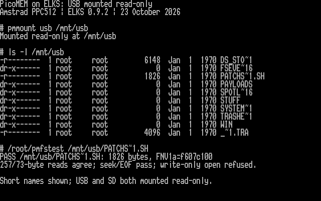
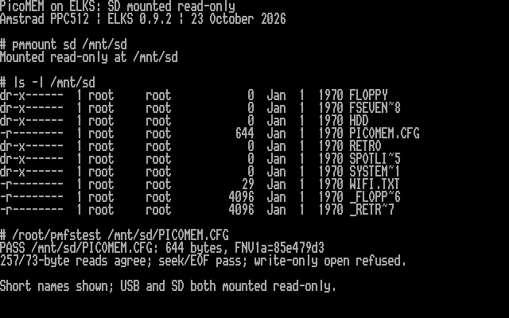

# PPC512: mounted PicoMEM USB and SD files, 23 October 2026

I built and tested an optional ELKS kernel with the existing PicoMEM mouse
driver and a new read-only `picofs` filesystem, with AI coding assistance.
**Both USB and SD mounted successfully on the real Amstrad PPC512.** Ordinary
ELKS file operations can now browse directories and read/copy files from them.
The mouse driver passed passive validation; movement/buttons remain unvalidated
because the USB port contains the Kingston flash drive, not a mouse receiver.

## Hardware and kernel

- Amstrad PPC512, i8086; PicoMEM 2 board 11, D000 ROM dated 2026-06-16.
- PicoMEM primary IRQ7; NE2000 at 300h/IRQ5; USB enabled.
- Kingston DataTravelerMini, reported 984.0 MB; previously identified FAT32.
- Existing SD-backed ELKS boot image remains `hd64-minix`, 63 MB, C130/H16/S63.
- ELKS baseline `e7a56a4334e0ef9a2261d1c2de54db31ba40fdf0`.
- Kernel build string: `23 Oct 2026 16:16:43 +0000`.
- Kernel file: 122056 bytes, SHA256
  `b807a1a567b647b7c4daad13e112c553bdff80b68ba2fdfd6779e3cfe2eb8d2e`.
- Link sizes: near code 64880, far code 36400, data 10704, BSS 9952 bytes.
  Near code has only 656 bytes of remaining segment space; the build manifest
  enforces segment limits for future additions.

[Exact binaries/configuration/manifest](../dist/kernel-20261023/README.md) ·
[Source, build instructions and limitations](../kernel/README.md).

## Validation

I ran 69 filesystem/transport scenarios under AddressSanitizer and UBSan on the
Mac and remote Linux build host. They execute the actual kernel source against
fake firmware. Thirty mouse-driver scenarios and all 524288 X/Y/button
combinations also passed. Integration installation is idempotent; a deliberately
unexpected shared-source edit is rejected before any integration file changes.

The combined native build completed with no diagnostics in the new filesystem
or mouse sources. Existing upstream warnings remain in the full build log.
I inspected native 8086 code: the transaction disables interrupts before the
profile check, uses bounded memory/port operations, and restores flags after
completion/error processing. Its internal far calls do not sleep or perform
BIOS I/O. Kernel data accesses use the compiler's required segment overrides.

A QEMU boot passed and rejected mouse, USB and SD access without PicoMEM present.
The first emulator image lacked device nodes and the required boot-options
header; correcting the image resolved that boot setup problem. This was an
image assembly issue, and the PPC had not been changed at that point.
[Emulator transcript](examples/kernel-qemu-20261023.txt).

After the user confirmed readiness, I installed the verified candidate on the
PPC and rebooted. Telnet returned. I then verified:

| Check | Result |
| --- | --- |
| Mouse passive check before mounting | Profile accepted; zero errors; not armed |
| USB mount | `/mnt/usb`, ten root entries |
| SD mount | `/mnt/sd`, ten root entries |
| Nested directories | USB `PAYLOADS`; SD `HDD` (eight image/metadata entries) |
| USB file read | `PATCHS~1.SH`, 1826 bytes, FNV1a `f607c100` |
| SD file read | `PICOMEM.CFG`, 644 bytes, FNV1a `85e479d3` |
| Different read sizes | Independent descriptors using 257/73-byte reads agree |
| Seek and EOF | Beginning/end seeks and EOF checks pass on both files |
| Write access | Write-only opens rejected; no write/truncate/create sent |
| Ordinary copy | Both files copied into ELKS storage and downloaded via FTP |
| Case-insensitive lookup | Lowercase paths pass the same read tests after remount |
| Busy unmount | Refused while a shell's current directory is inside USB |
| Mouse/filesystem exclusion | Mouse open returns EBUSY while mounted |
| Unmount/remount | Both volumes unmounted, mouse passive check passed, both remounted |
| USB/disk status after unmount | Kingston still detected; boot image/geometry unchanged |
| Configuration | All 768 sampled bytes match the pre-test snapshot |

The independently downloaded copies had these SHA256 values:

- USB file: `ab0b9eb8a8791272805fa31f02662ce38ac7deebc8e28b829c4256c3352aaf2a`.
- SD configuration: `0388f66f37583c7a82f9f6f1d92eee9b4cfa162dce201395e9ede19f0a25109a`.

I did not execute the script from USB, read `WIFI.TXT`, or publish card file
contents. Directory screenshots show filenames and metadata only. FNV hashes
from the PPC agree with independent host calculations over the copied files.

## Authentic console captures

These show native `ls` and `pmfstest` output, displayed on the PPC console and
captured from B800:0000 as 4000 text/attribute bytes. The title and command labels
provide context for replayed native output. Every displayed output row is
checked against the downloaded native text. Raw cells and checksum manifests
are retained alongside the rendered images; these are not emulator screenshots.





## Current installed state and limits

`/bin/pmmount` and `/bin/pmmouse` are installed. USB and SD are left mounted
read-only for manual testing. Mounts are not added to startup. Unmount both
before opening the mouse device:

```sh
pmmount -u /mnt/usb
pmmount -u /mnt/sd
pmmouse --check
```

The previous mouse-only kernel is backed up and readback-verified at
`/root/linprepf`, SHA256
`477f27738a0bc0e73ae9925b1dfea784ce7125e391621b58d03f58549fd788a8`.
The temporary `net=ne0` boot option used to reconnect after reboot was removed.
The restored 852-byte `/bootopts` exactly matches its original SHA256
`e0979659cddc2c04377e75abdc267dde25f7d8ccd3ddb8f2a1abf7b82a30eb7e`.
The unchanged 768-byte configuration snapshot has SHA256
`dceec78dca529be44b100b2dd79c7ad22719b22873b10792e9310f24e8a77691`.

This is a bounded prototype: 8.3 aliases, 64 nodes per mount including root,
127-character paths, no timestamps/capacity reporting, and cached directory
metadata until unmount. Firmware cannot distinguish directory EOF from a read
error. No hotplug, long-duration load, simultaneous mouse/storage operation,
real mouse movement, generic USB devices, or writable mounts are claimed.
The SD mount exposes the outer card filesystem, not a consistent snapshot of
an actively changing ELKS disk-image file. Do not remove either card while
mounted or use raw PicoMEM management commands concurrently.
