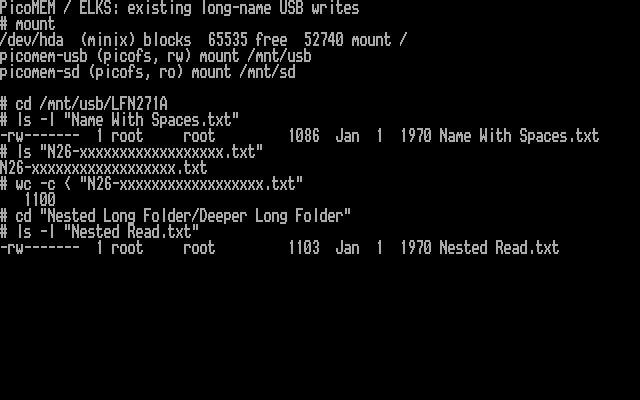

# Existing long-name USB writes, 28 October 2026

I tested the next ELKS kernel candidate on my PPC512, with AI coding
assistance. This step keeps the previously installed experimental PicoMEM
firmware. It enables writes to existing long-named files through their stored
8.3 aliases; creating new long names and rename are not implemented. SD remains
read-only.

## Before hardware writes

The host suites pass: 71 filesystem scenarios, 16 USB-write scenarios, 35 LFN
scenarios and 14 combined LFN/write scenarios. Mouse checks also pass. All
filesystem suites run with AddressSanitizer and UndefinedBehaviorSanitizer.
The new kernel boots in QEMU and rejects PicoMEM mounts when hardware is absent;
this does not emulate PicoMEM or prove hardware writes.

The PPC display extension is preserved. Segment sizes are 65,312 bytes near
code, 42,624 bytes far code, 10,864 bytes data and 10,208 bytes BSS. The existing
1,728-byte LFN table now also applies to an enabled USB writable mount.

Candidate SHA-256:
`73deeef63cd7aa0835da8c14e75b55ae130d8ca96db05cd50d2e6a99c04654d6`.
The current kernel and candidate were downloaded/read back and verified before
installation. The three test files have verified backups on the Minix root and
on the host; their hashes match the earlier Mac fixture manifest.

## Unsupported aliases

A structurally valid non-ASCII short alias is now omitted with a diagnostic
instead of making its whole containing directory inaccessible. The directory
is marked incomplete, blocking creation/removal there and preventing a false
empty-directory removal. Malformed FCB names still fail the scan. This preserves
access to supported siblings, but does not make the omitted Unicode file
accessible. The fixture's `UNIBAD` directory is retained to test this behavior.

The first candidate still rejected the Mac metadata sidecar’s non-ASCII FCB
`2e 5f 43 41 46 c3 a9 4e 54 58 54` (`._CAF…`). `ls` did not report the
read error, so its apparently empty listing was insufficient evidence. A native
probe exposed `EIO`. I captured that exact reply, added a regression, and fixed
the omission path before installing the final candidate above. On the PPC,
creation in `UNIBAD` now returns `EACCES` (13), and removing `UNIBAD` returns
`ENOTEMPTY` (39). Both original unsupported entries are retained.

## Hardware status

The final kernel booted on the PPC512 and exposed USB as `picofs, rw` and SD
as `picofs, ro`. The firmware was unchanged during this round.

| Existing file | Original bytes | Bytes after append and overwrite |
| --- | ---: | ---: |
| `Name With Spaces.txt` | 61 | 1,086 |
| `N26-xxxxxxxxxxxxxxxxxx.txt` | 75 | 1,100 |
| `Nested Long Folder/Deeper Long Folder/Nested Read.txt` | 78 | 1,103 |

Each native probe first required an exact match with its Minix backup, appended
1,025 deterministic bytes, overwrote 23 bytes across the 250-byte transfer
boundary, and verified the entire file in 73-byte reads including EOF. Separate
FTP downloads checked expected bytes on the host through all three long paths
and two corresponding short aliases.

After unmount/remount read-only, all three native read/seek/EOF tests passed
and write-only opens were refused. The host downloaded all five long/alias
paths again and verified the same expected bytes.

After remounting writable, `pmrwtest` created a fresh 8.3 test directory beneath
`Nested Long Folder`. Creation, exclusive-create refusal, append, overwrite,
truncate, deletion, open-file deletion refusal, mkdir/rmdir and directory-cache
checks passed. The retained 3,073-byte file matched an independent host-generated
pattern. This exercises short-name creation inside a long-named parent, not
creation of a new long basename.

I captured the screen below, restored all three original files through their
long paths (also exercising truncate-and-rewrite), removed only the temporary
write-test files/directories, and unmounted/remounted USB again. Independent
long-name and alias downloads match the original backup SHA-256 values. The
original fixtures, including the unsupported non-ASCII files, remain in place.
The PPC is left running this kernel with USB writable and SD read-only. The
previous kernel and fixture backups remain available on its Minix root.

This is a rendering of actual PPC video memory with its captured BIOS font.
The screenshot shows the temporary test sizes before restoration.
[Raw capture, native logs, build manifest and readback checksums](screenshots/captures-lfn-rw-20261028/)
are retained for review.

## Remaining work

This is still an experimental existing-file update path, not complete long-name
read/write support. New long-name creation, mkdir with a long basename and rename
need a bounded, versioned firmware interface and corresponding ELKS operations.
Existing long-name deletion is covered by the host harness, not by deletion of
the preserved hardware fixtures. Names above 26 ASCII bytes and Unicode remain
unsupported as display paths; supported ASCII aliases still work.

This round verifies persistence across unmount/remount, not power loss or a new
reboot after writing. The firmware still lacks a verified power-loss flush
guarantee. SD writes remain disabled.
