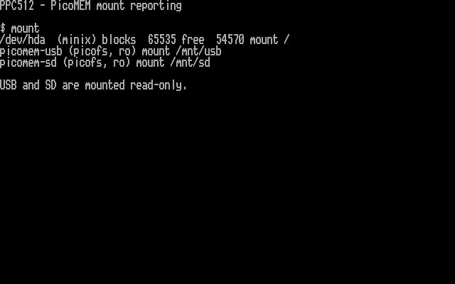

# PPC512: PicoMEM volumes visible in mount, 25 October 2026

I installed and tested the mount-reporting update on the Amstrad PPC512, with
AI coding assistance. The normal `mount` command now lists the real USB and SD
mountpoints, filesystem type and read-only status:

```text
picomem-usb (picofs, ro) mount /mnt/usb
picomem-sd (picofs, ro) mount /mnt/sd
```

The filesystem's new reporting callback supplies no invented capacity figures.
ELKS adds the actual mountpoint, flags, device identifier and filesystem type
from its superblock. The updated utility labels the device-less volumes without
looking for `/dev` block nodes. Reporting sends no PicoMEM commands; it also
remains available after a filesystem transport fault.

## Installation and reboot

I verified both the staged files and the installed files by FTP readback before
reboot. The previous kernel remains at `/root/linpre25` and the previous mount
utility at `/root/mntpre25`, also readback-verified. The first normal shutdown
refused to proceed because the root filesystem had an open write handle. After
closing a leftover FTP process, normal shutdown succeeded without the force
option. The PPC booted and DHCP assigned `10.0.0.69` instead of its previous
address. I verified the running kernel over telnet:

```text
ELKS elks 0.9.2 commit e7a56a43 25 Oct 2026 20:50:08 +0000 ibmpc i8086
```

The existing 851-byte `/bootopts`, which already enabled networking, was not
changed. Its post-test SHA256 still equals
`973e153eac521981cea88c239d44aa99d37e0efde428b1693ad16bf2490cd4ae`.

## Hardware checks

| State | Actual mount listing |
| --- | --- |
| After boot, before manual mounts | Minix root only |
| USB and SD mounted | Root plus both PicoMEM entries |
| USB unmounted | Root and SD only |
| SD also unmounted | Root only |
| Both remounted | Root plus both PicoMEM entries again |

I downloaded and checked all four saved transition listings:
[both](examples/20261025-mntboth.txt),
[SD only](examples/20261025-mntsd.txt),
[root only](examples/20261025-mntnone.txt),
[remounted](examples/20261025-mntfinal.txt).

The existing bounded file tests also passed:

- USB `PATCHS~1.SH`: 1826 bytes, FNV1a `f607c100`.
- SD `PICOMEM.CFG`: 644 bytes, FNV1a `85e479d3`.
- Independent 257/73-byte reads agreed; seeks and EOF worked; write-only opens
  were refused on both volumes. No file contents were published.
- Mouse passive validation passed before mounting and after both unmounts;
  reporting remained disabled and counters showed no errors.

Both volumes are left mounted read-only. No automatic mounts were added to
startup. Normal mount reporting does not add long filenames, writable access,
hot-removal support or capacity reporting. Mouse movement remains unvalidated.
Unmount both volumes before opening the PicoMEM mouse device.

## Console capture

I ran the installed `/bin/mount` directly onto the PPC console, with a title and
command label for context, then captured the 4000 B800:0000 character/attribute
bytes. This is a hardware text-screen capture, not an emulator or a constructed
terminal listing. I checked the USB/SD rows and visually inspected the rendering.
[Raw cells and checksum manifest](screenshots/captures-mount-20261025/) ·
[decoded screen text](examples/20261025-mount-screen.txt).



## Build and recovery references

[Exact tested binaries, configuration and source manifest](../dist/kernel-20261025/README.md).
The kernel uses 64944 bytes of near code, 64 bytes more than the previous build,
leaving 592 bytes before the 64 KiB limit. Native compilation, 71 filesystem
scenarios, 30 mouse scenarios, 524288 movement/button combinations, nine mount
listing cases and a QEMU boot passed before hardware installation.

- Installed kernel SHA256: `1d044390cf48e182d03dc277c9c449dd2cafba509d353668f0b6c743ab265a3c`.
- Installed `mount` SHA256: `3b766f73266ec999557b36c1d1458b7459161ffa3ff2ece15bf7e97af79c1dab`.
- Previous kernel SHA256: `b807a1a567b647b7c4daad13e112c553bdff80b68ba2fdfd6779e3cfe2eb8d2e`.
- Previous `mount` SHA256: `67d979cc634a28fa881ade53185a958a6e60091dffbc1bf2e72bc7b57a78bac4`.

Use the matching updated `mount` with this kernel: the older binary indexes a
fixed filesystem-name table without checking type 4. A backup kernel file alone
does not provide a recovery boot menu.
