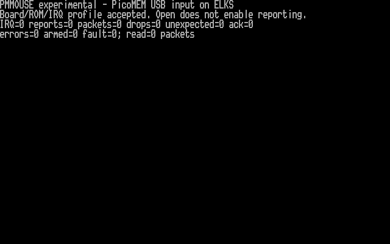
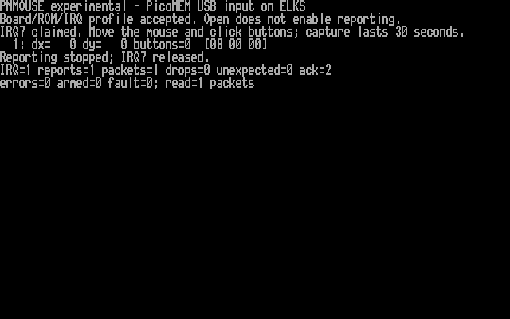
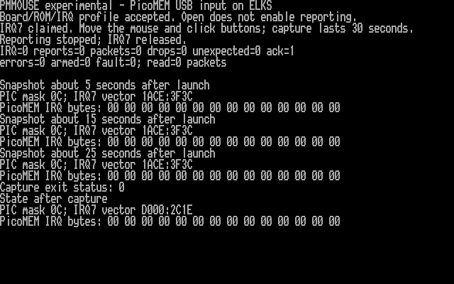

# Experimental mouse driver: PPC512, 23 October 2026

I built an optional PicoMEM mouse driver against the running PPC512 kernel's
source commit, `e7a56a4334e0ef9a2261d1c2de54db31ba40fdf0`, with AI coding
assistance. I preserved the original kernel locally and as `/root/linorig`.
The test kernel is installed at `/linux`; the capture program is
`/root/pmmouse`, with root-only `/dev/pmouse` (character device 4,33).

**Mouse investigation paused at the user's request.** Reporting remains disabled.
The experimental kernel is still installed; no rollback or reboot was performed.
The user may use a serial mouse later, after the serial link to the Mac is no
longer needed. Work moved to [USB flash-drive access](HARDWARE-USB-FLASH-20261023.md).

**Current acceptance: boot, passive validation and one interrupt/report received.
Movement/button validation has not passed; mixed disk/network load remains
pending.** No graphical application integration is claimed. Mouse reporting
was disabled cleanly after the capture.

## Evidence

- ASan/UBSan host tests: 28 driver scenarios and 524,288 X/Y/button combinations.
- Native IA16 build: no source warnings. A make jobserver warning is unrelated
  to generated code. The final kernel has 64,304 bytes of near code.
- An earlier candidate booted in QEMU and returned `ENODEV` without PicoMEM.
  This was a PC/486 emulator with 16 MB, not PPC or PicoMEM input emulation.
- The final candidate booted on the PPC: ELKS 0.9.2, commit `e7a56a43`, build
  `23 Oct 2026 13:54:42 +0000`. Telnet returned and passive validation passed.
- The installed kernel was downloaded again and matched the build byte for byte.
- The original boot options were restored byte for byte after temporary
  `net=ne0` startup. A final support dump confirms that all 768 configuration
  bytes still match the pre-test dump (SHA-256
  `dceec78dca529be44b100b2dd79c7ad22719b22873b10792e9310f24e8a77691`).
- Native `pmmouse --check` reports zero IRQs, reports, packets, drops, unexpected
  sources and errors; `armed=0`, `fault=0`.

The screenshot is rendered from the PPC's actual B8000 character/attribute
memory using its previously captured BIOS font. Each displayed row was checked
against the native output. [Text](examples/pmmouse-check-20261023.txt) and
[framebuffer provenance](screenshots/captures-pmmouse-20261023/manifest.json)
are retained.

## Second capture: one zero-motion report

I ran the bounded 30-second capture after the user signalled readiness. The
program completed successfully and received one packet, `08 00 00`: zero X/Y
movement and no buttons pressed. It reported one interrupt, one report, one
packet, zero drops, zero unexpected sources and zero errors. After stopping,
`armed=0` and `fault=0`. The two acknowledgments include the stop-time drain;
they do not represent two input events.

This demonstrates delivery of one PicoMEM mouse-source interrupt into the ELKS
queue, but does not establish sustained input, movement or button operation.
The report may have been pending before enable. The user subsequently confirmed
moving and clicking during this capture, and that this mouse/receiver pairing
works in DOS. This narrows the investigation to report delivery in the current
session and sustained IRQ handling; it does not yet establish a specific cause.

After the capture, the original PIC mask `0C` and IRQ7 vector `D000:2C1E` were
restored, all 14 shared IRQ bytes were zero, and a fresh passive check passed.
`pmstat --usb` still listed one Logitech Mouse. A new 964-byte support dump
matched the pre-capture dump byte for byte. Telnet and FTP remained usable;
this is not a mixed-load input stress test.

The complete [native output](examples/pmmouse-run2-20261023.txt) and
[framebuffer provenance](screenshots/captures-pmmouse-20261023/run2-manifest.json)
are retained. I displayed the native output on tty1, read the physical video
memory and verified every output row before rendering the screenshot.

## IRQ ownership finding

### Third capture: no pending request at three checkpoints

I repeated the 30-second capture with read-only IRQ snapshots approximately
5, 15 and 25 seconds after launch. No interrupts, reports or packets were
recorded. All three snapshots showed PIC mask `0C` (IRQ7 unmasked), the ELKS
handler at `1ACE:3F3C`, and all 14 shared IRQ/mouse bytes zero. After stopping,
the BIOS vector `D000:2C1E` was restored with mask `0C` and zero shared bytes.
The program exited successfully with no errors or faults; its single
acknowledgment was the stop-time drain.

These samples found no pending firmware request blocked by ELKS and no handler
replacement. They are snapshots, not a continuous trace, and do not prove that
the entire interrupt path is correct. The next diagnostic is receiver
re-enumeration followed by a capture; no kernel change is justified yet.

[Capture output](examples/pmmouse-run3-20261023.txt),
[IRQ snapshots](examples/pmmouse-diag3-20261023.txt), and
[framebuffer provenance](screenshots/captures-pmmouse-20261023/run3-manifest.json)
are retained. The screenshot shows both native logs together on the PPC console.

### Receiver reconnection and connection-light observation

After reconnecting the receiver, the user reported that its green connection
light stayed off, unlike on the DOS/Windows machine where the pair worked.
The successful comparison has not yet been established as a PicoMEM-hosted
test. I should not treat it as proof of this receiver's PicoMEM compatibility.

The subsequent `pmstat --usb` query still listed one Logitech Mouse. The PIC
mask remained `0C`, the vector was `D000:2C1E`, the shared IRQ bytes were zero,
and `pmmouse --check` passed without faults. I did not enable reporting again.
The inventory is a firmware snapshot, not proof of fresh enumeration or a
working wireless link. The LED's meaning needs the exact receiver model.

Next I will identify the receiver and, if available, compare a basic wired USB
mouse on the same PicoMEM port. USB power, host compatibility and receiver
initialization remain hypotheses, not established causes. The upstream
[USB mouse troubleshooting FAQ](https://github.com/FreddyVRetro/ISA-PicoMEM/wiki/PicoMEM-FAQ#usb-mouse--troubleshoot-a-not-working-mouse)
also identifies USB power and IRQ routing as checks; board-specific power
instructions must be verified for this PicoMEM 2 before changing hardware.

### Initial handoff correction

The first capture attempt was refused before sending mouse-enable: the initial
driver required IRQ7 to be masked. A read-only check found PIC mask `0C`, IRQ7
vector `D000:2C1E`, and all 14 PicoMEM IRQ bytes zero. This is the installed
PicoMEM BIOS handler, not evidence of another ELKS driver owning the line.

I changed the experimental driver to permit this exact ROM-verified BIOS
handoff. It still calls ELKS `request_irq()` and refuses an occupied ELKS IRQ
or an unknown unmasked vector. Successful stop restores the original BIOS
vector and mask bit. Separate host tests cover that handoff and refusal.

During the kernel audit I also found that ELKS `chq_addch_nowakeup()` executes
STI unconditionally. The driver uses a private queue append under its saved
interrupt state instead. Tests assert that packet queuing keeps interrupts
disabled throughout the shared-memory handshake.

## Artifact identities and recovery

| Artifact | SHA-256 |
| --- | --- |
| Original `/linux`, 114,968 bytes | `6763b9c6f062cde5cf152722c74e08eaf7474e4b92b31e225bd4959124480d23` |
| Experimental `/linux`, 116,744 bytes | `477f27738a0bc0e73ae9925b1dfea784ce7125e391621b58d03f58549fd788a8` |
| `/root/pmmouse`, 4,416 bytes | `f72e784a9eb777524ec1ccc6b9f31ea7fea99c281290a4744f901b6afbef8f88` |

The user confirmed access to the PicoMEM SD card for recovery. A backup kernel
file is not a boot menu. On a working ELKS system, copying `/root/linorig` back
over `/linux`, syncing and rebooting restores the original kernel. If ELKS
cannot boot, the SD image must be repaired or replaced externally. The original
boot options are also preserved as `/root/pmbootold`.

No NIC IRQ, memory map, persistent PicoMEM configuration or firmware was changed.
The experimental driver is inactive until explicitly armed by `pmmouse --run`.
