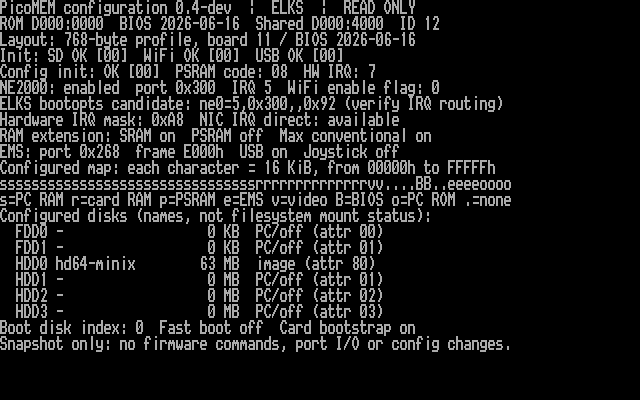
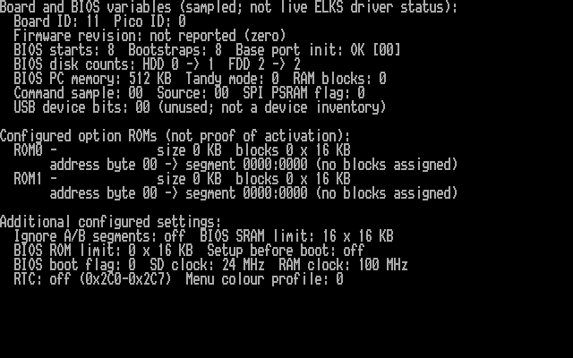
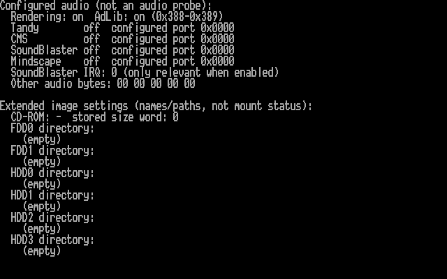
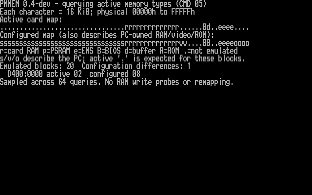
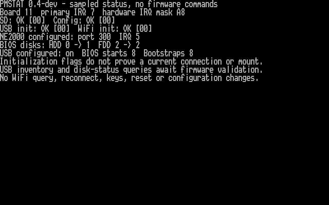
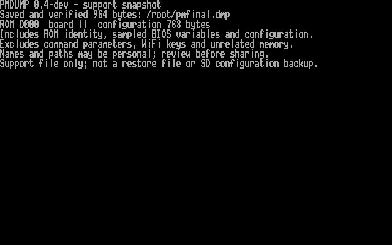

# PPC512 hardware round — 23 October 2026

I tested the native 0.3 and 0.4 development builds on the Amstrad PPC512 with
PicoMEM 2 (board 11), BIOS 2026-06-16 and ELKS 0.9.2 commit `e7a56a43`.
I used telnet and verified FTP transfers at `10.0.0.67`. Existing DOS bridge
processes held the serial device, so I left them alone. The machine's clock is
not set to the host date; ELKS file timestamps are not the test-date evidence.

## Results

| Check | Observed result |
| --- | --- |
| Final native executable | `pmconfig` 0.4-dev, 19,744 bytes; MD5 `56cdd47ffca7eb0d5b16a6bbf95d30df` |
| PMINFO/configuration inspection | Summary, `--details` and `--details -v` ran successfully; full 768-byte profile captured |
| PMDUMP | Created, synced and read back a 964-byte file; mode 0600; existing-file reuse refused |
| Host dump validation | Exact size, profile, reserved fields and CRC32 passed |
| PMSTAT | SD/config/USB/WiFi initialization flags all 00; NIC port 300, IRQ5; USB configured on; BIOS HDD count 0→1 |
| PMMEM first query | D000:0000 block 52 returned BIOS type 08 |
| PMMEM full query | All 64 blocks returned; 20 emulated blocks; one literal configured/active type difference at D400:0000 |
| Stage/show | An IRQ5→IRQ5 proposal was created and read back; no save was requested |
| Configuration preservation | All 768 configuration bytes matched the initial capture; complete before/after support bundles were also identical |
| Network/disk check | ELKS `curl` downloaded a known 68-byte file over HTTP, wrote it to the PicoMEM-backed disk, and FTP retrieved identical bytes; server logged HTTP 200 |
| Existing binary | `/bin/pmcfg` v0.2 retained MD5 `03c3f450610fa602626545fb6268f787` |

The HTTP file's MD5 is `82e836889beb01b7060de31c3ec08693`.
The configuration SHA-256 is
`dceec78dca529be44b100b2dd79c7ad22719b22873b10792e9310f24e8a77691`.
The downloadable [support record](examples/ppc512-support-20261023.dmp) passes
`python3 tools/read-dump.py FILE` and contains the same configuration.

No configuration save, reboot, cold power cycle, memory write probe, remapping,
active USB/disk query, WiFi query or audio probe was performed. The prior v0.2
save/reboot evidence remains in [the original test record](HARDWARE-TEST.md).

After validation I installed `/bin/pmconfig` and hard links `/bin/pmdump`,
`/bin/pmstat` and `/bin/pmmem`. All four match the final binary checksum.
`pmstat` and `pmmem --probe` also ran from their installed names. The original
`/bin/pmcfg` is unchanged, and the console is left displaying the memory map.

## Memory interpretation

The configured and active maps agree on 14 blocks of PicoMEM SRAM from 80000h
through B7FFFh: **224 KB added above the PPC's original 512 KB**. BIOS data area
word 0040:0013 reports **736 KB** of conventional memory. ELKS's boot log reports
735K RAM; these are separate observations, not a RAM write-test result.

The active map reports D0000h as BIOS (08h) and D4000h as shared buffer (02h).
The configured map labels both blocks as BIOS (08h), so the literal comparison
prints one difference. D4000h is also where this board's shared variables and
configuration were read. This difference is not evidence of a RAM fault.
PC-owned RAM/video/ROM entries correctly appear as un-emulated in the active
card map.

This gives a measured baseline for future 512/640 KB testing. The current tool
cannot select those profiles. A next-boot profile implementation still needs
firmware-setting semantics, backup/rollback and reboot validation. It must not
remove RAM underneath a running ELKS kernel.

## Screenshots

I captured the final 0.4 native output to files on ELKS, retrieved it unchanged,
and displayed it on `/dev/tty1` in pages of at most 23 lines. Each page was then
read from physical B8000h using:

```sh
dd if=/dev/kmem of=screen.bin bs=16 skip=47104 count=250
```

The 4,000 character/attribute bytes were fetched by FTP. Every displayed row
was checked against the corresponding native-output line. The existing
`tools/render-text.py` rendered them with the PPC BIOS 8×8 font captured in the
previous round, doubling scan lines to 640×400. These are actual framebuffer
captures of paginated native output, not simulated terminal images. I inspected
all six PNGs for complete, legible content.

[Raw screen cells and hashes](screenshots/captures-20261023/manifest.json) are
included. The manifest also records the font hash; the font itself remains
in the local hardware evidence directory.

Configuration summary, lines 1–22 of the details report:



Board/BIOS variables, option ROMs and additional settings, lines 24–43:



Audio and image directories, lines 45–67:



Active versus configured memory:



Passive status:



Verified support dump:



## Text evidence and build checks

- [Complete report including all raw configuration bytes](examples/pmconfig-all-20261023.txt)
- [Decoded report](examples/pmconfig-details-20261023.txt)
- [Memory comparison](examples/pmconfig-memory-20261023.txt)
- [Passive status](examples/pmconfig-status-20261023.txt)
- [Support dump result](examples/pmconfig-dump-20261023.txt)
- [Binary checksums and build provenance](../dist/README.md)

All 85 host tests/scenarios passed. The IA16 build completed without warnings.
I inspected the query function's complete assembly, including error/timeout
branches: no calls occur between CLI and flag restoration. The existing save
critical section was inspected as well. Hardware execution validates this
specific board/firmware/ELKS combination; it does not establish compatibility
with other profiles or long-running command handlers.
