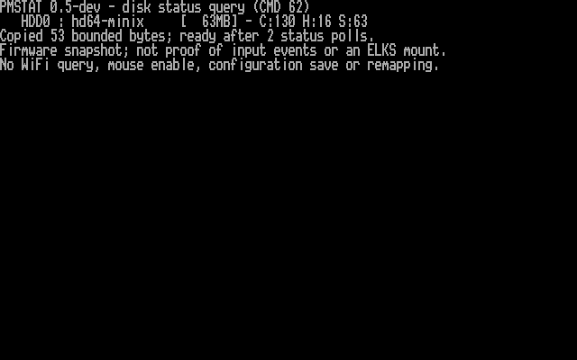

# PPC512 USB receiver and disk-status round — 23 October 2026

I tested `pmconfig` 0.5-dev on the Amstrad PPC512 with PicoMEM 2 board 11,
BIOS 2026-06-16 and ELKS 0.9.2 `e7a56a43`. A wireless mouse receiver was plugged
into PicoMEM's USB port. I used telnet/FTP; I did not reboot or alter the kernel.

## Receiver detected

```text
PMSTAT 0.5-dev - USB status query (CMD 61)
   USB  : 1 device
    1: Logitech Mouse
Copied 43 bounded bytes; ready after 2 status polls.
```


This confirms PicoMEM's cached inventory classifies the connected receiver as
a Logitech mouse. It does not prove pairing, movement/button delivery or input
in ELKS applications. No mouse-enable command was sent. The next input work is
the [ELKS driver integration described here](ELKS-MOUSE.md).

## Disk metadata

```text
PMSTAT 0.5-dev - disk status query (CMD 62)
   HDD0 : hd64-minix     [  63MB] - C:130 H:16 S:63
Copied 53 bounded bytes; ready after 2 status polls.
```



The command returns firmware image/geometry metadata. It does not independently
establish ELKS filesystem mount state or perform a disk surface test.

## Checks and installation

- The 21,088-byte native binary was built without warnings with IA16 GCC 6.3.0
  using the same prepared ELKS toolchain and small-model flags as 0.4.
- All **114 host tests/scenarios passed**, including 28 new status-transaction
  cases. Tests cover forbidden commands, ownership failures, response limits,
  stale/unterminated data, sanitization, fast completion, errors and timeouts.
- The generated memory, save and status critical sections were checked through
  all reachable branches between CLI and POPF. None calls a library/system
  function while interrupts are disabled.
- FTP upload/readback and ELKS MD5 verified the candidate before it ran:
  `ab0a42b5cd55a5757004ddc32f636c97`.
- The first disk query returned after 3 status polls; the first USB query also
  returned after 3. Repeated queries and installed-command runs returned after
  2. These counts exclude setup/copy time and are not milliseconds.
- Before/after 964-byte support bundles were **byte-for-byte identical**:
  MD5 `78c123ac396dd48ccb4857b6d78c7d5c`. All 768 configuration bytes are unchanged.
- ELKS downloaded a known 42-byte file through the PicoMEM NIC to the boot disk.
  The HTTP server logged 200; FTP readback matched the host file exactly, with
  MD5 `4c24f5e7d4276d4a407d527d8034c04b`.
- I installed the candidate as `/bin/pmconfig`; the existing `/bin/pmstat`,
  `/bin/pmdump` and `/bin/pmmem` hard links share it. All four checksums match.
  Installed `pmstat --usb`, `pmstat --disks` and passive `pmstat` ran successfully.
- The prior 0.4 executable is preserved on the PPC512 as `/root/pmold04`, and in
  the repository as [dist/pmconfig-0.4-dev](../dist/pmconfig-0.4-dev).
  Original `/bin/pmcfg` v0.2 is unchanged.

The new queries write only their bounded command scratch and management-port
registers. They do not save configuration, enable mouse reporting, query WiFi,
reconnect networking, change memory mappings or probe audio. No cold-start
persistence test or kernel-driver test was performed.

## Captures and reproducibility

I redirected the native query results to files on ELKS and retrieved them by
FTP. Each result was then displayed unchanged on `/dev/tty1`. I read 4,000
character/attribute bytes from B8000h, verified every displayed line against the
native result, and rendered the screen using the previously captured PPC BIOS
font with `tools/render-text.py`. Both PNGs were visually checked. These are
hardware framebuffer captures, not generated terminal mockups.

- [Exact USB text](examples/pmstat-usb-20261023.txt), including its trailing space
- [Exact disk text](examples/pmstat-disks-20261023.txt)
- [Raw cells and source/font hashes](screenshots/captures-pmstat-20261023/manifest.json)
- [Protocol and limits](TOOLS.md#pmstat-passive-and-explicit-query-modes)
- [Binary provenance](../dist/README.md#tested-development-build-05-dev)

The complete baseline configuration is unchanged from the earlier
[0.4 hardware record](HARDWARE-TEST-20261023.md). These tests validate this
specific firmware/profile and receiver, not every USB device or firmware build.
