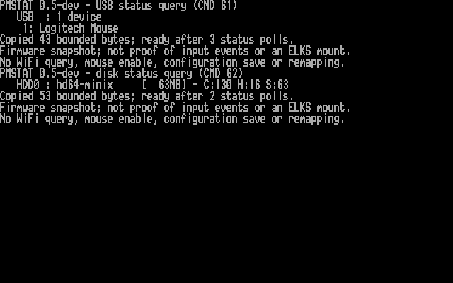
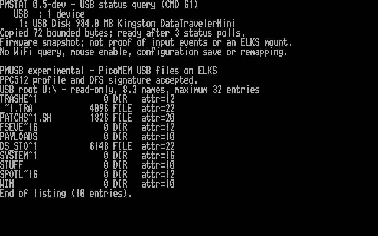

# PPC512 USB flash-drive investigation — 23 October 2026

I paused mouse testing at the user's request and tested a Kingston
DataTraveler, reported as 1 GB and FAT32. After a physical power cycle, PicoMEM
detected it and my experimental native ELKS `pmusb --list` retrieved ten root
directory entries. No flash files were written. The original boot options
were restored byte for byte; no disk mapping, PicoMEM configuration, firmware
or kernel was changed in this USB test. The experimental mouse kernel remains
installed with mouse reporting disabled.

## Initial result: stale inventory

Two USB queries still returned one **Logitech Mouse**. The disk query returned
only `HDD0: hd64-minix [63MB]`, the existing ELKS boot image. Passive status
reported USB configured on and initialization OK, which does not prove current
USB operation. ELKS showed `/dev/hda` mounted as its Minix root filesystem.
The pre-created `/dev/hdb` through `/dev/hdd` nodes do not establish that those
drives exist; I did not attempt to mount them.

I checked the query implementation: it fills the bounded response buffer with
`FF` before issuing the command and requires a replacement reply. Therefore,
the mouse label came from a fresh firmware response rather than an old output
buffer in `pmstat`. The old entry persisted after receiver replacement and
after a Ctrl+Alt+Del warm restart.



[Native output](examples/usb-flash-status-20261023.txt) and
[framebuffer provenance](screenshots/captures-usb-flash-20261023/manifest.json)
are retained. I displayed the native output on tty1, captured B8000 video
memory, checked each output row and visually inspected the rendered screenshot.

## Cold start and successful directory access

I temporarily added `net=ne0` to `/bootopts`, preserved the original locally
and as `/root/usbbootold`, and shut ELKS down cleanly. After the user confirmed
physical power OFF, a ten-second wait and power ON with the Kingston inserted,
telnet returned and `pmstat --usb` reported:

```text
USB Disk 984.0 MB Kingston DataTravelerMini
```

I restored `/bootopts` and downloaded it to verify byte-for-byte equality with
the original (SHA-256
`e0979659cddc2c04377e75abdc267dde25f7d8ccd3ddb8f2a1abf7b82a30eb7e`).

I built the separate experimental [USB client](../usb/README.md), ran 52
ASan/UBSan host transaction scenarios, compiled it for 8086 and inspected the
native critical section. Its passive check accepted the actual hardware and
the DFS signature at D000:4FC4. The corrected directory search then returned
ten entries, including `PAYLOADS`, `STUFF` and `WIN`.



[Native listing](examples/usb-list-20261023.txt),
[combined screen text](examples/usb-access-screen-20261023.txt), and
[framebuffer provenance](screenshots/captures-usb-flash-20261023/access-manifest.json)
are retained. The image is rendered from the PPC's captured video memory.

The deployed `/root/pmusb` is 4,960 bytes, SHA-256
`ed3e586be3bf6a2d21ac7355fd87ab7b633d72f6e9755cfab02682acd032c25a`.
FTP upload/readback matched the build. After listing, telnet/FTP, USB/disk
status and the passive client check still worked. All 768 PicoMEM
configuration bytes matched the pre-test snapshot (SHA-256
`dceec78dca529be44b100b2dd79c7ad22719b22873b10792e9310f24e8a77691`).

This establishes device detection and directory metadata access. It does not
establish file-content reads, writes, an ELKS mount, or reliable hotplug. A
cold start cleared the stale inventory in this test; the underlying cause
has not been identified. Mouse input testing remains paused.

## ELKS access path and limitations

PicoMEM documents full SD/USB file access through its modified EtherDFS service
and DOS PMDFS redirector, not automatic creation of an ELKS USB block device.
See the [upstream description](https://github.com/FreddyVRetro/ISA-PicoMEM#disk-emulation).

In the examined firmware source, command `89h` dispatches a request from the
shared disk buffer to `ethdfs_docmd()`. That service maps logical `U:` to the
USB filesystem `1:` and `S:` to the SD filesystem `0:`. `pmusb` permits only
USB-root FINDFIRST/FINDNEXT, with interrupt-disabled ownership of the shared
buffer per command and bounded, validated replies. It never sends a write,
create, delete, format or remount request.

The initial prototype sent `*.*` and received no matches. The firmware's FCB
converter requires an already expanded `????????.???` mask; correcting the
request produced the ten entries. The firmware also conflates end/no matches
with directory-read errors, so a zero-entry result cannot prove an empty disk.
File-content access and a mounted ELKS filesystem remain separate next steps.
