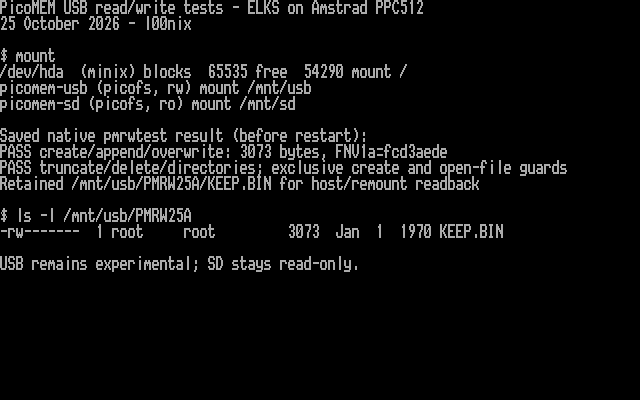

# PPC512: experimental USB read/write tests, 25 October 2026

I implemented and tested optional PicoMEM USB writes on my Amstrad PPC512,
with AI coding assistance. This uses PicoMEM's file service through `picofs`,
not a USB block driver. SD writes remain disabled because that card hosts the
running ELKS disk image. Long filenames remain a separate firmware-interface task.

## Installation

I verified the staged and installed files by full FTP readback before reboot.
The current kernel and mount helper were saved as `/root/linprerw` and
`/root/mntprerw`, with matching readback checksums. An old telnet session initially
held the USB mount busy; installation stopped before changing the kernel.
The session had exited by the next attempt, and both volumes unmounted normally.
No forced unmount or forced reboot was used.

The new kernel booted successfully and telnet returned at `10.0.0.69`:

```text
ELKS elks 0.9.2 commit e7a56a43 25 Oct 2026 21:45:45 +0000 ibmpc i8086
```

The 851-byte `/bootopts` was unchanged. Its SHA256 remains
`973e153eac521981cea88c239d44aa99d37e0efde428b1693ad16bf2490cd4ae`.
The previous kernel remains available for SD-card recovery; a backup file alone
is not a boot-menu fallback.

## Tests on the Kingston USB drive

I first mounted both volumes read-only. The existing native read/seek/EOF tests
passed, including rejection of write-only opens:

- USB `PATCHS~1.SH`: 1826 bytes, FNV1a `f607c100`.
- SD `PICOMEM.CFG`: 644 bytes, FNV1a `85e479d3`.

I then unmounted USB and explicitly mounted it read/write:

```sh
pmmount --rw usb /mnt/usb
/root/pmrwtest /mnt/usb/PMRW25A
```

The tester required a new directory and did not overwrite existing user files.
It passed exclusive creation, append, overwrite across a transfer boundary,
truncate-to-empty with `O_TRUNC`, file deletion, directory creation/removal,
rejection of duplicate exclusive creation and rejection of open-file deletion.

```text
PASS create/append/overwrite: 3073 bytes, FNV1a=fcd3aede
PASS truncate/delete/directories; exclusive create and open-file guards
Retained /mnt/usb/PMRW25A/KEEP.BIN for host/remount readback
```

Ordinary ELKS `cp` copied that file into the Minix root and back onto USB as
`COPY.BIN`. I downloaded both copies to the Mac and compared every byte with
an independently generated fixture. Both matched. I removed `COPY.BIN` with
ordinary `rm`, leaving only `KEEP.BIN` in the test directory.

After unmounting USB and mounting it read-only, the new file passed differently
sized reads, seek, EOF and write-open rejection. A fresh FTP download matched
again. The original USB and SD reference checksums also remained unchanged.
`pmmount --rw sd /mnt/sd` rejected the request with usage exit code 2; the host
suite separately verifies the kernel and transport reject SD writes directly.

The retained fixture has:

- Size: 3073 bytes.
- FNV1a: `fcd3aede`.
- SHA256: `d45c5305b8dd48af787ecfd75dcbedbdf6fca682fef83824fb39c5372eafd441`.

## Restart, final state and evidence

I unmounted both volumes, performed another normal ELKS reboot, remounted both
read-only and repeated all three file tests successfully. A fresh Mac download
of `KEEP.BIN` still matched every expected byte and the SHA256 above. This was
a normal restart, not a physical power-off or a power-loss durability test.

I then remounted USB read/write for further testing. SD remains read-only:

```text
picomem-usb (picofs, rw) mount /mnt/usb
picomem-sd (picofs, ro) mount /mnt/sd
```

No automatic mounts were added to startup. After a reboot, mount explicitly:

```sh
pmmount --rw usb /mnt/usb
pmmount sd /mnt/sd
```

The retained test directory contains only `KEEP.BIN`. For another native write
test, choose a **different new** 8.3 directory name; rerunning `PMRW25A` is
intentionally refused. Finish with `pmmount -u /mnt/usb` before removing media,
from a shell whose current directory is outside that mount.

[Native tester output](examples/20261025-usb-rw-native.txt) ·
[final mount listing](examples/20261025-usb-rw-mount.txt) ·
[independent readback records](examples/20261025-usb-rw-readbacks.json).
The expected bytes are `(offset * 29 + 11) & 255`, except offsets 249 through
271 inclusive, which are `(255 - offset) & 255` after the overwrite test.

## Console capture

I displayed the live mount and directory listings on the PPC console, together
with the saved native test output labelled as being from before the restart.
Titles and labels provide context. I captured the actual 4000 character/attribute
bytes at B800:0000 and rendered them with the PPC's captured BIOS font. The image
is a hardware text-screen capture; it does not represent another run of the
write test. [Raw cells and checksum manifest](screenshots/captures-usb-rw-20261025/)
and [decoded screen text](examples/20261025-usb-rw-screen.txt) are retained.



## Limits

This remains experimental. It supports bounded 8.3 filenames and a 64-node
mount cache. Rename, sparse writes, general truncate and persistent permissions
are not implemented. The firmware masks close errors and has an unreliable
mkdir result; the driver verifies observable outcomes and does not retry
ambiguous mutations. An error can follow a partial change; it is not a rollback.
Readback does not guarantee durability through power loss. No hot-removal or
surprise-power-loss test is claimed. Use backed-up test media and unmount before
removing the USB drive. Keep SD read-only.

[Exact tested build and recovery hashes](../dist/kernel-usb-rw-20261025/README.md) ·
[Source and remote-build instructions](../kernel/README.md).

The [long-filename proposal](LONG-FILENAMES.md#current-ppc512-screenshot) includes
a second hardware capture with `ls -l /mnt/usb`, showing the current 8.3 aliases
alongside the USB read/write and SD read-only mount entries.
