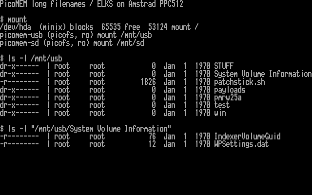
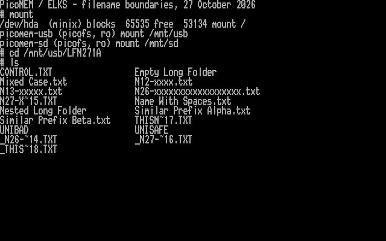
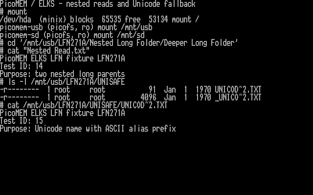

# Long filenames: experimental implementation and hardware tests

I am implementing a paired firmware/ELKS extension, with AI coding assistance.
**Existing long-name USB writes now pass on the PPC512:** append and overwrite
work through 26-character ASCII names and nested long-name paths. USB writable
mounts display long names; SD stays read-only. New long-name creation and rename
remain future firmware/ELKS work. Default builds remain alias-only.

[28 October write tests, safeguards and screenshots](HARDWARE-LFN-RW-20261028.md)
describe the newer kernel. The sections below retain the earlier read-only
tests and the failure that led to the unsupported-alias handling change.

## PPC512 hardware test, 27 October 2026

I backed up and verified the board's complete 16 MiB flash, installed the
experimental RP2350 firmware, and verified its readback and live ROM descriptor.
The original firmware reports a June 21 build. The test kernel preserves the
PPC's existing display extension; networking and the display status command
work after reboot.

- A Kingston DataTravelerMini (984 MB reported, user-formatted FAT32) mounts
  read-only and lists `System Volume Information`, `patchstick.sh` and original
  mixed-case directory names.
- Reads of `patchstick.sh`, `PATCHS~1.SH` and `PATCHSTICK.SH` produce identical
  1,826-byte files with SHA-256
  `ab0b9eb8a8791272805fa31f02662ce38ac7deebc8e28b829c4256c3352aaf2a`.
- A nested read through `System Volume Information/IndexerVolumeGuid` matches
  `SYSTEM~1/INDEXE~1` byte-for-byte. The long nested path also reads on SD.
- USB and SD unmount successfully after the reads, then remount successfully.
  The earlier busy-unmount report did not recur in this controlled test; this
  does not establish that every cause of busy mounts is resolved.
- A USB read/write mount lists aliases, as designed, and unmounts successfully.
  No USB/SD write operations were exercised during this LFN hardware session.
- Both volumes are left mounted read-only for inspection. Dot-prefixed long
  names follow normal `ls` hiding rules; use `ls -a` to include them.

This is a rendered capture of the PPC's actual mode-3 video RAM, using its
captured BIOS font. `mount` and `ls` ran on the PPC; no directory output was
synthesized. [Capture evidence and checksums](screenshots/captures-lfn-20261027/).

One unrelated behavior difference is recorded: the newer upstream firmware
forces `PSRAM_Ext=0` when `USE_SPI_PSRAM` is disabled for PicoMEM 2. It now
reports PSRAM extension off, while conventional SRAM emulation remains active.
The LFN patch does not change that initialization code. This limits any claim
of full equivalence to the original released firmware.

The tested firmware UF2 SHA-256 is
`e60d8a8a3067f45ff8dccd7b2209156fe0fe7712087ebca4bb72742c4f5d133f`;
the PPC kernel SHA-256 is
`7e2ced612d7dda3560355630cb97766ad28bc3810a8d8311831c6639e9eaec26`.

## Controlled USB filename fixture, 27 October 2026

I created a small, separate `LFN271A` folder on the Kingston using the Mac,
recorded reference hashes, and tested it on the PPC without changing firmware
or kernel. USB was unmounted before each physical move. Two round trips to
the Mac and back worked without a PPC reboot; this does not test unplugging
a mounted volume.

- 12-, 13- and 26-character ASCII names display and open in full. The
  27-character name displays as `N27-X~15.TXT`; the 44-character name uses
  `THISN~17.TXT`. Neither name is truncated into a false display path.
- Spaces, mixed case, a hidden name, two nested long directory names and
  distinct files with similar prefixes read correctly. Uppercase lookup and
  short aliases still work, including an alias for a parent directory.
- **21 reads match the Mac SHA-256 references:** 15 reads of 14 distinct files
  (including a case variant), followed by six additional alias reads after
  unmount/remount. This excludes the known-failing file described below.
- Two native `pmfstest` runs also pass chunked reads, seek/EOF and refusal of
  write-only opens. USB unmount/remount succeeds. A writable mount lists aliases;
  no USB/SD writes were performed by ELKS in this fixture session.
- USB and SD are left mounted read-only. The fixture's files were created or
  rearranged only on the Mac; existing user files were not modified.

These are rendered captures of actual PPC video memory, using the captured
BIOS font. Underscore-prefixed 4,096-byte files are Mac metadata sidecars.
[Fixture manifest, checksums, native command logs and capture evidence](screenshots/captures-lfn-fixture-20261027/).

### Failure found on 27 October: non-ASCII short aliases

The initial `Café notes.txt` test made its entire containing directory
unreadable. A bounded capture of the legacy DFS reply contains FCB bytes
`43 41 46 c3 a9 4e 4f 54 54 58 54`. The existing client rejects the non-ASCII
bytes before any long-name lookup and discards the partial directory snapshot.
Other USB and SD files still read, and USB unmounted normally. This is a
reproducible compatibility gap, not a successful Unicode test.

I preserved that file and its metadata sidecar in `LFN271A/UNIBAD` on the Mac.
Isolating it let the other tests run; **the 27 October kernel did not fix it**. A separate
`Unicode café.txt` file in `UNISAFE` has the ASCII alias `UNICOD~2.TXT`, and
reads through that alias match the reference hash. Therefore Unicode fallback
is currently supported only when the legacy alias itself is supported ASCII.
Do not recursively scan `UNIBAD` expecting it to work with this kernel.

[Captured original failure and successful unmount](screenshots/20261027-lfn-failure.png).
The 28 October kernel now omits these unsupported entries with a diagnostic,
keeps supported siblings accessible and blocks creation/removal in that
incomplete directory. Full Unicode path support remains separate work.

## Integrated experimental candidate, 27 October 2026

The [firmware fork](https://github.com/l00nix/ISA-PicoMEM/tree/codex/dfs-long-names)
now includes a default-off DFS handler, and `kernel/picofs-lfn.inc` connects it
to mounted ELKS paths behind `CONFIG_FS_PICOMEM_LFN`. The
[firmware build and protocol notes](https://github.com/l00nix/ISA-PicoMEM/blob/codex/dfs-long-names/LFN-EXPERIMENT.md)
record dependencies, limits and remaining hardware checks.

- Names up to 26 ASCII characters, including spaces and mixed case, appear in
  ordinary directory listings and work in lookup. Aliases continue to work.
- Longer names, Unicode and ambiguous display names fall back to supported
  ASCII 8.3 aliases. Non-ASCII aliases have the known directory failure above.
- Firmware operations always use aliases, including nested parent paths.
- Long names are enabled only for **read-only** USB/SD mounts. USB read/write
  mounts keep aliases; long-name creation/rename is not implemented.
- Stock firmware receives **no new query**: the client requires the exact
  experimental ROM descriptor before sending the provisional DFS subfunction.
- Additional heap allocation is 1,728 bytes per enabled read-only mount, bounded
  to 64 nodes. No table is allocated on stock firmware or writable mounts.

The generic candidate kernel built with 65,280 bytes near code, 41,424 bytes
far code, 10,768 bytes data and 10,192 bytes BSS. It boots in QEMU and refuses
mounts when PicoMEM is absent. These results do not simulate the PicoMEM device.
The separate hardware candidate also preserves the PPC's existing display
extension; its final build manifest is retained with the local test artifacts.

Validation includes 35 LFN driver scenarios plus existing filesystem, USB-write
and mouse tests, 498 firmware payload checks, 10,000 malformed requests and
692 dispatcher checks under sanitizers. Generated FAT12 and FAT32 images exercise the
actual upstream FatFs code, both drive numbers, a nested alias-only read,
fallback and cursor independence, with zero disk writes. Both complete ARM
firmware variants build; the default variant has no LFN handler/ROM descriptor.

To build the generic candidate, set `KERNEL_CONFIG` to
`kernel/ppc512-lfn.config` with `kernel/build.sh`, or pass `--lfn` to
`kernel/remote-build.py`. Default build settings remain unchanged. The
[original offline helpers](../experimental/lfn/README.md) retain the payload
format and tests; the actual driver uses a smaller, separately allocated table.

Legacy DOS compatibility, precise USB/FAT32 service time, interrupt latency,
hot-unplug while mounted and actually restoring the saved firmware remain to
be tested. The controlled fixture above covers length boundaries and limited
Unicode fallback, and exposes a non-ASCII-alias failure. Adversarial display/
alias collisions remain host-tested only. A separate
bounded scan for every directory entry can be expensive. Start with a small
read-only USB fixture and retain the actual original firmware and kernel.

## What prevents an ELKS-only fix

PicoMEM's FatFs configuration enables long filenames and uses UTF-8 at its API.
Its directory reader receives both `FILINFO.fname` and the short `altname`.
However, `fs_find()` selects the short alias and converts it to an 11-byte DOS
FCB name. The DFS FINDFIRST/FINDNEXT replies contain that name in a fixed
24-byte record; the original long name is absent. Increasing the ELKS name
buffer cannot reconstruct information the firmware does not send.

I checked both the locally audited PicoMEM revision
`be7b2e6031ae93bb75733c363489aa9171a7205c` and the corresponding current default-
branch source files through GitHub. Both show this behavior:

- [FatFs LFN configuration](https://github.com/FreddyVRetro/ISA-PicoMEM/blob/be7b2e6031ae93bb75733c363489aa9171a7205c/src/lib/FatFs_SPI/include/ffconf.h#L116).
- [Directory reader chooses the short alias](https://github.com/FreddyVRetro/ISA-PicoMEM/blob/be7b2e6031ae93bb75733c363489aa9171a7205c/src/lib/my_etherdfs/fs.c#L238).
- [DFS serializes the 24-byte reply](https://github.com/FreddyVRetro/ISA-PicoMEM/blob/be7b2e6031ae93bb75733c363489aa9171a7205c/src/lib/my_etherdfs/ethersrv-pico.c#L343).

The ELKS baseline also limits a directory entry's name to **26 bytes**.
`struct dirent` embeds `d_name[MAXNAMLEN+1]`; the kernel's readdir callback
truncates at that limit. For ASCII filenames, 26 bytes means 26 characters.
This is distinct from Minix's on-disk name limit. Changing the constant alone
would break compatibility with existing programs' directory buffers: the
readdir syscall ignores its count argument. Full-length names require a
compatible directory API design and corresponding libc/application changes.

- [ELKS name limit](https://github.com/ghaerr/elks/blob/e7a56a4334e0ef9a2261d1c2de54db31ba40fdf0/elks/include/linuxmt/limits.h#L49).
- [Directory structure](https://github.com/ghaerr/elks/blob/e7a56a4334e0ef9a2261d1c2de54db31ba40fdf0/elks/include/linuxmt/dirent.h).
- [Directory syscall](https://github.com/ghaerr/elks/blob/e7a56a4334e0ef9a2261d1c2de54db31ba40fdf0/elks/fs/readdir.c#L26).

Do not probe the existing OPEN operation with long basenames. The audited
server splits the basename into a 16-byte local buffer using a copy without a
destination-length parameter. A new ELKS client must keep sending bounded short
aliases through that existing path; a long-name display is not permission to
send an arbitrary long name to the old firmware.

## Original implementation design

1. Add a versioned, read-only PicoMEM extension that resolves an existing short
   path to its original long basename. Keep the existing DOS replies unchanged.
   Request parsing must validate all sizes before copying. Use a separate
   metadata lookup so it does not disturb the shared directory cursor.
2. For the first ELKS implementation, request names that fit the existing
   26-byte directory API. Return an explicit too-long/unsupported-encoding
   result for other names, with the existing alias retained. Do not truncate
   long names into ambiguous or unopenable paths. A bounded reply can fit the
   current 256-byte payload; no shared scratch enlargement is required.
3. Keep each node's short alias for firmware operations and its optional long
   display name for ELKS lookup/readdir. Build firmware paths exclusively from
   aliases, including parent directories. Support lookup through either name.
4. Initially accept safe ASCII names, including interior spaces and mixed case.
   Validate components and reject control characters, separators and dot entries.
   If a display name collides case-insensitively with another node's display name
   or alias, fall back to the short alias. Resolve this over the complete bounded
   directory snapshot before publishing entries. UTF-8 display/case handling is
   separate follow-up work.
5. Enable the extension only after its capability/version and hardware profile
   are verified. Unsupported firmware continues with existing short names.
   Command numbers and capability advertisement need agreement with the firmware
   implementation. The candidate uses a provisional DFS subfunction 0x70, gated
   by an exact ROM descriptor; it does not probe unknown commands on stock firmware.

This would improve ordinary `ls`, `cat` and `cp` on both mounts for names that
fit, without replacing every ELKS application. Longer names would still use
aliases. Full names beyond 26 bytes need a second phase with ELKS maintainers;
a dedicated listing utility could display longer names through a future extended
interface, but that would not give ordinary mounted-path operations full support.

## Validation before hardware deployment

The firmware side needs parser tests for length bounds, absent/media-changed
files, UTF-8 handling, and unchanged legacy DFS replies. The ELKS side needs
fixtures for 12/13/26/27-byte boundaries, spaces, mixed case, duplicate prefixes,
name/alias collisions, nested directories and old-firmware fallback. Checks must
prove opens still send short aliases, failed lookups do not corrupt snapshots,
and mouse/DFS ownership remains enforced. Test names should be placed on a
separate USB fixture by a host, initially mounted read-only for long-name tests.
The separately tested USB-write support does not yet create long filenames.

The tested USB-write kernel has only 272 bytes of near-code headroom. New logic
must respect the near/far segment budget and bounded heap use, then pass native
build, host tests and emulator boot before a planned firmware/kernel hardware
test. The experimental interface still needs upstream review; writable mounts retain
their 8.3-name restriction.

## Current PPC512 screenshot

I captured the live `mount` and `ls -l /mnt/usb` output on the PPC512. USB is
mounted read/write and SD read-only, but the directory listing still exposes
short aliases such as `PATCHS~1.SH`, `SYSTEM~1` and `TRASHE~1`. The original long
names cannot be inferred from these aliases. Titles and command labels provide
context; the directory output comes from the actual installed ELKS `ls`.

[Raw video-memory capture and checksum manifest](screenshots/captures-usb-lfn-20261025/) ·
[decoded screen text](examples/20261025-usb-lfn-screen.txt).
