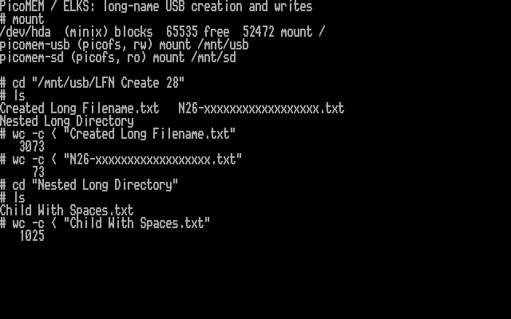

# Long-name creation candidate

I am developing the next USB filesystem milestone as l00nix, with AI coding
assistance. The `codex/long-name-create` branch adds optional creation of files
and directories with names up to 26 ASCII bytes. The paired kernel and firmware have now passed PPC512 creation and write
tests, including full-byte readback after remount and a normal reboot. This
remains an experimental candidate, not a release candidate. The earlier existing-file
write tests remain documented [separately](HARDWARE-LFN-RW-20261028.md).

## What changes

The matching firmware branch is
[`codex/dfs-long-name-create`](https://github.com/l00nix/ISA-PicoMEM/tree/codex/dfs-long-name-create).
Its [protocol notes](https://github.com/l00nix/ISA-PicoMEM/blob/codex/dfs-long-name-create/LFN-CREATE-EXPERIMENT.md)
describe a separate, default-off USB creation command. The earlier metadata-only
PR remains separate. No new PR is opened for this candidate before hardware tests.

ELKS requires `CONFIG_FS_PICOMEM_LFN_CREATE`, the existing LFN/write options,
and the exact additional firmware ROM descriptor before querying creation
capabilities. Old firmware receives no creation query. Read-only and SD mounts
never enable the feature. Ordinary `open(O_CREAT)` and `mkdir` use the new
command when supported; file contents continue through the verified alias-only
legacy read/write path. Deletion continues through aliases too.

The driver scans the parent, rejects collisions and incomplete namespaces,
and reserves its node/inode before sending a mutation. The response must provide
a valid, unique alias and the exact requested name, attributes and zero size.
A separate legacy attribute query checks the created alias before it is exposed.
I/O failures, malformed responses or ambiguous completion latch a fault; the
client does not retry a mutation that may already have happened.

Limits remain deliberate: no rename, no SD writes, no Unicode or names longer
than 26 bytes, no leading dot/space or trailing dot/space for new names, and a
127-byte alias path with room reserved for the returned alias. Filesystem
snapshots remain bounded to 64 nodes. Unmount before removing media. This is
not a guarantee of safe removal while mounted or power-loss durability.

## Build and validation

Use `KERNEL_CONFIG=/path/to/kernel/ppc512-create.config` with `kernel/build.sh`,
or `kernel/remote-build.py HOST WORKDIR CROSSDIR OUTPUT --lfn-create`.
The saved PPC hardware build also preserves the existing PPC display extension.
All defaults remain unchanged.

Host sanitizer suites pass the existing filesystem, write and LFN tests plus
21 creation scenarios. These cover old-firmware fallback, long-name lookup and
alias identity, nested creation, 26-byte names, remount, duplicate-name refusal,
unsupported-alias safeguards, SD/RO protection, capacity refusal, malformed
replies and ambiguous transport faults. The IA16 build and QEMU boot pass;
QEMU verifies absence-of-hardware handling, not PicoMEM creation itself.

On the firmware side, disposable FAT12 and FAT32 images exercise the actual
bundled FatFs source. Independent mtools reads verify newly created long names
and payload. Failed sync/close, bounded scans, collision/no-overwrite checks,
SD denial, malformed requests and cursor/PSRAM cleanup have host coverage.
Default, metadata-only and creation firmware variants build independently.

[Offline logs, build hashes and configurations](validation/lfn-create-20261028/)
are retained for review. The staged hardware kernel has SHA-256
`ed2b14c22e8b734032bf3b0d75654ee4b8f175edd419ac2d396a46f54c253581`;
the creation UF2 has SHA-256
`e8fd1de4f89bec53920a3d9491e0513486d202973f01ecf3d7f5615eef3d80a8`.
The kernel uses 65,312 bytes near code, 44,336 far code, 10,880 data and 10,208 BSS.
The creation firmware links 4,800,392 flash bytes and 377,660 RAM bytes. These
are build-fit figures, not runtime stack/heap measurements.

## Hardware test procedure

1. Preserve the current ELKS kernel and save/readback-verify the actual installed
   PicoMEM flash through BOOT mode before changing it. Keep the original full-flash
   recovery image as well. Only PicoMEM 2 / RP2350 is supported by this candidate.
2. Install the tested kernel with the display extension retained. With old
   firmware, confirm normal mounts and refusal of long-name creation.
3. Shut down ELKS and connect PicoMEM's USB-C in BOOT mode for firmware backup,
   flash and readback verification. Then boot the PPC normally.
4. Mount the disposable USB fixture writable and SD read-only. Use a fresh,
   nonexistent test directory, for example:

   ```sh
   /root/pmlfnnew "/mnt/usb/LFN Create 28"
   ```

   This creates new fixture files and directories and tests append, overwrite,
   truncate, delete and refusal cases. It leaves a 3,073-byte main file, a
   1,025-byte nested file and a 73-byte file with a 26-character name for
   independent checks. Never reuse an existing test directory.
5. Verify long-name and alias downloads, unmount/remount, normal reboot, and
   an unmounted move to the Mac. Verify FAT consistency and full names there,
   then confirm DOS alias access. Keep SD read-only throughout.

Rename and measured interrupt/service latency remain later work before a
broader read/write release candidate. Direct Mac filesystem checks and DOS checks of this creation build remain
pending; the earlier DOS result applies to the metadata-only firmware.


## PPC512 results, 28 October 2026

I installed the candidate kernel and first booted it with the older metadata-only
firmware. Normal mounts and existing file reads passed; a request to create a
long-named directory failed without creating it. I then saved all 16 MiB of the
actual PicoMEM flash and verified the backup against the device. The creation
firmware passed flash readback verification, and ELKS saw both exact ROM feature
descriptors after boot.

With USB mounted read/write and SD read-only, `pmlfnnew` created a fresh
`LFN Create 28` directory. Exclusive file creation, append, overwrite across a
transfer boundary, nested directory/file creation and a 26-byte basename passed.
The probe also verified truncate-to-empty, file deletion, empty-directory removal,
refusal to unlink an open file, duplicate-create refusal and directory-cache
contents after deletion. The nonempty parent was retained.

| Retained file beneath `LFN Create 28` | Bytes |
| --- | ---: |
| `Created Long Filename.txt` | 3,073 |
| `Nested Long Directory/Child With Spaces.txt` | 1,025 |
| `N26-xxxxxxxxxxxxxxxxxx.txt` | 73 |

Independent FTP downloads to the Mac matched every expected byte immediately,
after unmount/remount, and after a clean ELKS reboot. These downloads exercise
the ELKS/PicoMEM file path; they are not yet a direct Mac FAT filesystem check.
The original three test files matched their backups before creation and after
remount. SD stayed read-only throughout.



The screenshot renders actual PPC video memory using its captured BIOS font.
[Raw capture, native hardware log and readback hashes](screenshots/captures-lfn-create-20261028/)
are retained for review. The three new fixtures remain on the test drive for
independent Mac and DOS verification. A clean reboot is not a power-loss test.
