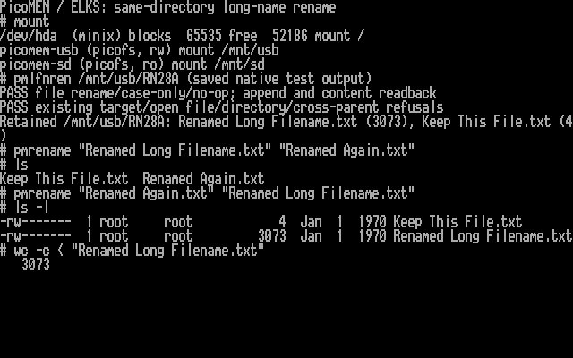

# Same-directory file rename candidate

I am developing this next milestone as l00nix, with AI coding assistance, on
`codex/long-name-rename`. It builds on the hardware-tested long-name creation
candidate. **Rename has passed host/FAT-image tests, an 8086 build, emulator boot and
PPC512 rename tests with independent byte checks after remount and a normal reboot.** This is not
a release candidate.

## Scope and commands

The candidate renames regular files within one USB directory, including changes
of case. It refuses replacement of an existing file, open files, directory
renames and moves between parents. SD remains read-only. Names are limited to
26 ASCII bytes; the existing path, namespace and mutation restrictions apply.

```sh
pmmount --rw usb /mnt/usb
pmrename '/mnt/usb/Test/Old Long Filename.txt' '/mnt/usb/Test/New Long Filename.txt'
```

`pmrename` makes one `rename()` call and reports failure. Use this command for
the candidate. The pinned ELKS `mv` can unlink an existing destination before
calling `rename()` and can fall back to copy/delete; its behavior would bypass
some of the intended test restrictions. The no-replacement guarantee described
here applies to the PicoMEM rename operation, not arbitrary shell commands.

For a fresh test directory, `pmlfnren /mnt/usb/NEWTEST` exercises rename,
case-only changes, unchanged-name handling, append/readback after rename and
refusals for collisions, open files, directories and cross-parent moves. It
retains `Renamed Long Filename.txt` (3,073 bytes) and `Keep This File.txt` (4 bytes)
for independent verification. It refuses an already existing test directory.

## Kernel and firmware

Use `kernel/ppc512-rename.config` with `kernel/build.sh`, or pass `--lfn-rename`
to `kernel/remote-build.py`. The new `CONFIG_FS_PICOMEM_LFN_RENAME` option requires
creation, LFN and USB-write support. The saved PPC build also preserves its
existing display extension. All rename options default off.

The paired firmware is
[`codex/dfs-long-name-rename`](https://github.com/l00nix/ISA-PicoMEM/tree/codex/dfs-long-name-rename);
[protocol details](https://github.com/l00nix/ISA-PicoMEM/blob/codex/dfs-long-name-rename/LFN-RENAME-EXPERIMENT.md).
A separate exact ROM descriptor and capability response gate command `0x72`.
Older firmware receives no rename command. Earlier metadata and creation
commands are unchanged. The original metadata-only upstream draft PR remains
separate; this branch is not a new upstream PR.

The pinned ELKS syscall normally implements rename through link/unlink. A small
conditional callout routes PicoMEM paths directly to the driver; other
filesystems retain the existing implementation. The driver holds the parent
lock, requires a complete namespace, checks the source and destination, and
keeps the same inode number. It sends the source alias, expected attributes and
size, and the new basename. Firmware independently verifies the parent, refuses
collisions, calls FatFs once, then verifies the new name, alias, attributes,
size and disappearance of the old alias when the alias changes.

ELKS validates that reply and independently queries the legacy alias before
updating its name cache. An ambiguous error latches a fault; it does not retry
or attempt a rollback that could destroy data. Unmount/recovery and independent
inspection may be needed after a failed mutation. This does not promise atomic
recovery from power loss or safe unplugging while mounted.

## Validation and remaining work

- Firmware protocol/adapter sanitizer tests cover framing, bounds, invalid names,
  SD/directory denial, collisions, metadata mismatch, bounded scans, filesystem
  errors and PSRAM cleanup.
- Real bundled FatFs tests on disposable FAT12 and FAT32 images pass rename,
  case-only rename, collision refusal, remount and payload checks. Independent
  mtools reads find the new long name and exact payload.
- ELKS sanitizer tests cover 24 rename scenarios and 12 syscall routing/reference
  scenarios, in addition to the existing creation, write, LFN and mouse suites.
- Fresh and repeated integration into the pinned ELKS checkout pass without
  duplicate configuration declarations.
- IA16 kernel build: near text 65,360 bytes, far text 46,576, data 10,912 and BSS
  10,208. The near segment has only 176 bytes free.
- QEMU boots the kernel, checks absent-hardware handling and utility usage,
  and successfully renames/reads a Minix file while the old name disappears.
- Firmware builds with rename disabled reproduce the previous stock,
  metadata-only and creation UF2 hashes exactly.

Before considering a release candidate I still need DOS compatibility checks
for this firmware and runtime stack/service-latency measurements. QEMU
cannot validate the actual PicoMEM file service. Directory moves, overwrite
semantics, Unicode and SD writes are outside this milestone.

## PPC512 results — October 28, 2026

The paired kernel and firmware booted successfully. I verified all three exact
ROM descriptors on the PPC, then mounted USB read/write and SD read-only.
`pmlfnren` passed file rename, case-only rename, unchanged-name handling,
append after rename and byte readback. Existing-target, open-file, directory
and cross-parent requests were refused as expected. The `pmrename` command
also renamed a fixture and renamed it back successfully.

Independent FTP reads matched all 3,073 bytes of the renamed file and the
four-byte collision fixture. Both also matched after unmount/remount and a normal reboot; the old
and intermediate names were absent. All three retained creation-test files
still matched their previous hashes.



This screenshot is rendered from the PPC's actual text video memory using its
BIOS font. The probe output is the saved native test output; the displayed
`pmrename`, `ls`, `mount` and `wc` commands were executed on the PPC.

The tested kernel SHA-256 is
`f47981b9551bc8c1793fc0a5604d405568f6b7a9197d8b428a3c0085dd762fc8`; firmware UF2
is `79055e63295aad3901d23ff17a93882ec3cf3cc8c5dd4702c36a5205626e31c8`.
The full prior flash was saved and verified before flashing; the previous
kernel is backed up. These are experimental tests, not power-loss testing.

[Machine-readable validation summary](validation/rename-ppc512-20261028.json).

### Direct Mac verification

The Kingston was unmounted in ELKS and connected to the Mac. The Mac saw
exactly the two expected long names in the rename-test directory, with no old,
intermediate or rejected names left behind. Both files matched the original
byte counts and SHA-256 hashes. The three creation-test fixtures also retained
their previous contents.

After unmounting the volume, `fsck_msdos -n` checked the FAT, directories and
orphan clusters and returned exit code 0. No repair was requested. The stick
was then safely ejected. This verifies a normal clean unmount, not recovery
from sudden removal or power loss.

After reconnecting the Kingston to PicoMEM with ELKS still running, USB
remounted read/write without a reboot. Independent FTP reads again matched
both rename fixtures byte for byte; the old and intermediate names remained
absent. All three earlier creation fixtures still matched as well. SD remained
read-only throughout.
