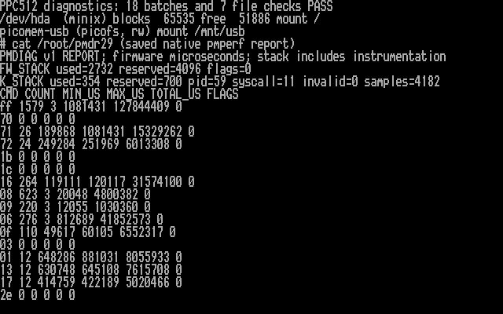

# Optional runtime diagnostics candidate

I have tested the paired ELKS kernel and PicoMEM 2 firmware on the PPC512 to
measure file-service latency and observed peak stack use. All 18 workload
batches and seven full-file checks after remount passed. This remains a
diagnostic candidate, not a release candidate.

The [earlier baseline](RUNTIME-VALIDATION.md) measured complete operations from
the host, including telnet/TTY overhead. This candidate adds microsecond
measurements taken on PicoMEM itself, plus stack watermarks in both systems.

## PPC512 results — October 29, 2026

I installed the verified kernel and firmware after saving recovery copies.
The Kingston DataTravelerMini mounted read/write after connection. The workload
used a fresh `PMDIAG29` directory: reads, writes, rename pairs, long-name file
creation/deletion and directory creation/removal, plus no-op batches. All 18
batches passed. Full host reads matched all bytes in the new 3073-byte payload
and six earlier fixtures, both before and after clean unmount/remount. SD was
not mounted or written during this run.

| Stack observation | Used | Reserved |
| --- | ---: | ---: |
| PicoMEM core 0, after workload | 2732 bytes | 4096 bytes |
| ELKS syscall stack, after workload reset | 354 bytes | 700 bytes |
| ELKS syscall stack, after subsequent remount | 358 bytes | 700 bytes |
| ELKS syscall stack, initial pre-reset observation | 418 bytes | 700 bytes |

The firmware peak leaves 1364 bytes in this workload and exceeds the previous
2048-byte reservation by 684 bytes. This supports keeping the 4 KiB reservation;
it does not establish a worst-case bound or demonstrate corruption in an older
build. The reset deliberately excludes earlier mount/startup activity. All
firmware flags and kernel invalid-paint counts were zero.

The post-workload report counted 1579 firmware commands totaling 127.844409
seconds. It includes fixture setup and the verification reads between batches;
these totals are not confined to the host's timed windows. Selected command
measurements are below, converted from microseconds to milliseconds:

| Firmware command | Count | Mean ms | Maximum ms | Total seconds |
| --- | ---: | ---: | ---: | ---: |
| `06` close, mixed read/write handles | 276 | 151.640 | 812.689 | 41.853 |
| `16` open | 264 | 119.599 | 120.117 | 31.574 |
| `71` long-name creation, files/directories | 26 | 589.587 | 1081.431 | 15.329 |
| `01` remove directory | 12 | 671.328 | 881.031 | 8.056 |
| `13` delete file | 12 | 634.642 | 645.108 | 7.616 |
| `0f` get attributes | 110 | 59.567 | 60.105 | 6.552 |
| `72` rename | 24 | 250.555 | 251.969 | 6.013 |
| `09` write payload | 220 | 4.683 | 12.055 | 1.030 |

Open and close account for 57.4% of cumulative firmware service time in this
workload. I will investigate their metadata and flush costs before changing
transfer sizes. These command-level timings do not isolate `f_open`, `f_stat`
or `f_sync`, and they do not justify removing synchronization. The existing
[close-error limitation](../kernel/README.md) still needs attention before a
release-candidate claim.

Host timings include the added stack tracing as well as telnet/TTY overhead,
so this run is not a performance improvement comparison with the uninstrumented
baseline. No power-loss or media-error injection was performed.



This screenshot is rendered from actual PPC text video memory and its BIOS
font. It shows native `mount` output and the saved native `pmperf` report taken
immediately after the benchmark. The seven-file summary reflects the later
independent post-remount checks; the displayed counters have not been replaced
with post-remount values.

[Raw native report](validation/pmperf-ppc512-20261029.txt) and
[samples, artifact hashes, stack readings and file checks](validation/runtime-diag-ppc512-20261029.json).

## Build and use

The kernel option `CONFIG_FS_PICOMEM_DIAG` defaults off. The dedicated
`kernel/ppc512-diag.config` enables it with the existing USB long-name creation
and rename options. It requires `CONFIG_FARTEXT_KERNEL`; full `CONFIG_TRACE`
must remain disabled. Build in a dedicated pinned ELKS checkout, or use the
existing remote build helper:

```sh
python3 kernel/remote-build.py BUILD_HOST /absolute/build-dir /absolute/cross-dir ./output --diag
```

Pair it with the firmware's default-off `PICOMEM_EXPERIMENTAL_DIAG` option,
which also requires the rename extension and 4 KiB core-0 stack reservation.
See the [firmware protocol and build notes](https://github.com/l00nix/ISA-PicoMEM/blob/codex/runtime-diagnostics/RUNTIME-DIAGNOSTICS.md).

After both candidates have been installed and USB mounted, root can run:

```sh
pmperf --reset /mnt/usb
# Run a bounded workload in a fresh test directory.
pmperf /mnt/usb
```

`pmperf` queries the mounted USB root through ioctl `0x5044`. It cannot query
SD or an arbitrary file, and the kernel refuses the diagnostic command before
I/O unless the ROM has the exact independent PMDG descriptor. Old firmware
continues to support normal file operations; it cannot supply these metrics.
Query/reset changes only diagnostic RAM, never media contents.

## Interpreting the report

`FW_STACK` reports observed core-0 stack use out of 4096 bytes. `K_STACK`
reports the greatest observed ELKS syscall-stack use out of 700 bytes, with
its PID and syscall number, invalid-paint count, and completed sample count.
It covers all tasks after reset, including the measurement utility itself.

Each command row contains count, minimum, maximum and total microseconds.
Command `ff` is the aggregate. For a nonzero count, total/count gives the
mean service time. The firmware interval includes DFS dispatch and PSRAM
restoration; it excludes the PC-side wait/transport and diagnostics queries.
The host benchmark still provides the separate end-to-end measurement.

Flag bit 0 means a 32-bit count or total saturated; bit 1 means firmware stack
painting was invalid. `pmperf` fails on either flag, a kernel invalid-paint
count, or a reported stack use reaching its reservation. Reset before each
bounded run; the aggregate total saturates after about 71.6 minutes of summed
service time. Individual commands must complete within one timer wrap.

Stack painting uses the actual stack pointer, masks interrupts, and preserves
an inactive gap below the live frame (64 bytes on PicoMEM, 16 on ELKS).
Measurements include instrumentation overhead. The firmware watermark can
include core-0 interrupt use; the ELKS measure covers syscall paths, not its
separate interrupt stack. Neither reports PicoMEM core-1 stack use. Observed
peaks are workload evidence, not a proof of worst-case bounds or protection
against stack overflow.

The firmware reply reserves bytes 28–51 as zero. After validating that reply,
the kernel fills bytes 32–47 with its own stack metrics; format version 1 is
at bytes 42–43. Firmware and kernel statistics are separate snapshots, not an
atomic global observation.

## Validation and hardware plan

The host tests, real FAT32-image checks, native build and emulator boot passed
on October 29, 2026. Emulator checks include unsupported diagnostic requests
and ordinary Minix rename behavior. The candidate uses 65392 bytes of near
code, leaving 144 bytes in that segment. ARM and IA16 disassembly checks
confirmed that the stack painters use the live SP without calling helpers
inside the painting loop. [Preflight results and artifact hashes](validation/runtime-diag-preflight-20261029.json).

Host tests cover request/reply bounds, exact ROM gating, root and USB-root
restrictions, malformed replies, copy failures, counter saturation, timer
wrap, query exclusion, stack-paint boundaries and preservation of live frames.
Existing long-name tests remain part of the build. The ARM link map must
retain separate 4 KiB core-0 and 2 KiB core-1 reservations without scratch
code/data overlap. The 8086 kernel must fit its 16-bit segments.

Before installation I saved and verified the running kernel and a full PicoMEM
flash recovery image. Firmware programming passed readback verification. The
hardware test above then repeated the bounded workload and post-remount byte
checks. Further error-path validation and performance investigation remain.
