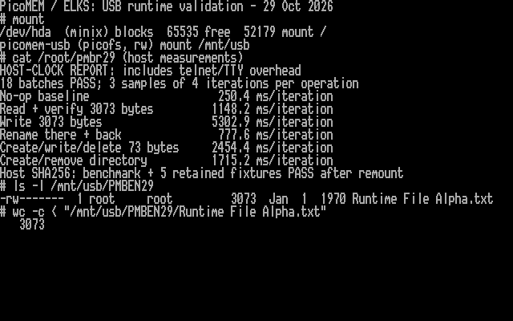

# Runtime validation: first hardware baseline

I have completed the first host-timed workload on the PPC512 using the rename
kernel and the firmware's opt-in 4 KiB core-0 stack reservation. All 18 batches
passed, and full-file reads passed again after remounting. This is still
experimental work, not a release candidate. No kernel change was needed.

## Stack preflight

The IA16 compiler reports 130 bytes for `rename_inner`, 60 for `scan`, 96 for
`lfn_scan`, 14 for `lfn_query` and 32 for `transaction`. Caller frames, helper
functions and interrupt entry also matter: these numbers are not a complete
stack bound or runtime high-water result. The PPC configuration reserves
700 bytes per kernel stack. Full kernel tracing is currently disabled, and
the kernel's near code segment has only 176 bytes free.

The firmware compiler audit found a legacy delete path with at least 2112
bytes of nested frames against a 2048-byte core-0 stack reservation, before
deeper FatFs/USB calls or interrupts. An opt-in firmware candidate now reserves
the otherwise empty 4 KiB SCRATCH_Y bank for core 0 while retaining core 1's
2 KiB allocation. Its build/map checks pass and flashing passed readback
verification after saving a full recovery image. ELKS boot and the hardware
workload now pass; actual stack high-water measurements remain pending. See the
[companion firmware audit](https://github.com/l00nix/ISA-PicoMEM/blob/codex/runtime-validation/RUNTIME-VALIDATION.md)
for the frame breakdown.

## PPC512 results — October 29, 2026

I ran three batches of four iterations for each operation on the Kingston
1 GB FAT32 USB drive. The table gives the median of the three batch averages,
in milliseconds per iteration. Every value includes telnet/TTY overhead;
rename and create/remove entries represent a complete pair of operations.

| Operation | Median ms/iteration | Range of batch averages |
| --- | ---: | ---: |
| No-op baseline | 250.4 | 250.2–258.4 |
| Read and verify 3073 bytes | 1148.2 | 1097.5–1189.7 |
| Write 3073 bytes | 5302.9 | 5294.7–5350.2 |
| Rename there and back | 777.6 | 776.7–779.3 |
| Create, write 73 bytes, delete | 2454.4 | 2341.2–2459.2 |
| Create and remove directory | 1715.2 | 1704.4–1773.0 |

The no-op **whole batch** took about one second. I have not subtracted that
overhead or treated these values as firmware-only timings. The three samples
per operation establish a first baseline, not a latency distribution or a
worst-case bound. Writes are the clearest performance target in this workload.

The workload verified its retained payload after every batch. Independent
host FTP reads matched all 3073 bytes afterward, along with the five earlier
creation/rename fixtures. USB unmounted and remounted read/write successfully;
all six files matched their expected SHA-256 hashes again. Only
`Runtime File Alpha.txt` remained in the fresh `PMBEN29` directory. SD was not
written, and the kernel remained unchanged.



This image is rendered from the PPC's actual text video memory and BIOS font.
`mount`, `ls` and `wc` ran on ELKS; the explicitly labelled host timing report
was displayed with `cat`. It is not an ELKS-clock measurement.

[Raw samples, artifact hashes and full-file checks](validation/runtime-ppc512-20261029.json).
The tested firmware UF2 SHA-256 is
`4e144a3ed4f1a40db9da79043fe4660fe9e0c4f8a71253f962622a2e46efef13`.
The previous firmware and full flash recovery image remain saved.

## Host-timed workload

Build `kernel/pmbench.c` with the normal 8086 utility flags, or use
`kernel/build.sh`. The workload is controlled by a host handshake; it is not
intended to run unattended directly from the ELKS command line.

Once the candidate is ready and the USB is mounted read/write, use Python
3.9–3.12 on the host (the harness uses `telnetlib`):

```sh
python3 tools/measure-pmbench.py PPC_ADDRESS /mnt/usb/PMBEN29 results.json
```

The native binary must already be at `/root/pmbench` on the PPC, or supply
`--program /path/to/pmbench`. The harness logs in as root with the test
machine's existing passwordless telnet setup. It refuses to overwrite an
existing result file. Use a **new** test-directory name of 1–8 uppercase
letters/digits. The workload refuses any existing directory and writes only
inside the one it creates. SD is never accessed.

Each operation runs three batches of four iterations:

| Operation | One iteration |
| --- | --- |
| `noop` | Empty loop iteration, for transport-overhead context |
| `read3073` | Open, read and verify 3073 bytes plus EOF, close |
| `write3073` | Open/truncate, write 3073 bytes, close |
| `rename_pair` | Rename a closed file to another long name and back |
| `create_unlink` | Exclusively create a long-name file, write 73 bytes, close, delete |
| `mkdir_rmdir` | Create and remove an empty long-name directory |

The retained payload is verified after every batch, outside its timed window.
On successful completion only `Runtime File Alpha.txt` remains: 3073 bytes,
with byte `j` equal to `(j * 17 + 23) & 255`. A failure stops the workload and
retains its directory for inspection; do not automatically retry or delete it.

The Mac measures from sending `go` to receiving the complete `DONE` line.
Results include network, telnet, TTY and process scheduling overhead. The
no-op baseline is reported separately, never subtracted. Paired operations
are reported **per pair**, not per individual syscall. These are end-to-end
wall times, not PicoMEM service times or disk-only throughput.

The ELKS transaction masks interrupts while waiting for PicoMEM, so an ELKS
tick-based timer could under-report the delay. Accurate firmware service
timings will need separate instrumentation using the PicoMEM clock.

## Preparation checks

- Host sanitizer test passed all 18 batches, exact final payload, refusal to
  reuse a directory, name restrictions and abort on invalid handshake.
- Native 8086 build passed with warnings treated as errors.
- PPC native utility startup and staging readback passed. USB mounted
  read-only and both retained rename payloads matched their original bytes.
- The stack-reservation firmware is flashed and readback verified; ELKS boot,
  all 18 workload batches and post-remount file checks pass.

## Remaining before release-candidate consideration

I still need measured peak stack use in the kernel and firmware, plus
firmware-clock service timings. A larger reservation and successful workloads
do not establish a worst-case stack bound. Those measurements should guide
any changes to write performance. This run does not test sudden removal or
power-loss recovery, and it does not expand the supported rename semantics.
