# USB cache flush and timeout containment candidate

I have prepared the next firmware-only step toward reliable PicoMEM USB writes.
**REQUEST SENSE confirms the Kingston rejects the cache-flush opcode. Read checks pass; writes remain blocked pending cache-mode investigation.**
The existing diagnostics kernel and utilities are sufficient. SD remains read-only.

The preceding [file-service error milestone](FILE-SERVICE-ERRORS.md) reports
failures, but its USB timeout could leave the controller pointing at a caller's
old buffer. This candidate gives USB a permanently allocated 512-byte buffer.
After an uncertain operation, it stops USB I/O until PicoMEM restarts and keeps
that buffer reserved, including when a completion arrives late. It also checks
USB transfer lengths, completion status and command identity more strictly.

Filesystem synchronization now sends a real device-cache flush command. Before
the first sector write, the firmware tests whether the drive supports that flush.
Unsupported or failed flushes stop the operation; a failed close cannot silently
report success. This does not prove protection against power loss or provide
transactional writes. The Kingston returned command-failed status for the flush; the later sense diagnostic below identifies an invalid command opcode.

The candidate is default-off on `codex/usb-sync-lifetime`. See the
[firmware design, build instructions and test plan](https://github.com/l00nix/ISA-PicoMEM/blob/codex/usb-sync-lifetime/USB-SYNC-LIFETIME.md)
and [artifact/test manifest](https://github.com/l00nix/ISA-PicoMEM/blob/codex/usb-sync-lifetime/USB-SYNC-LIFETIME.json).

Local validation covers 578 cases in the actual TinyUSB state machine, 56 adapter
scenarios with memory-error sanitizers, five real FAT32/mount scenarios, and the
existing LFN/create/rename/diagnostic/error regressions. A normal long-name file
was independently read with mtools; a simulated unsupported flush caused zero
sector writes. Firmware RAM use increases by 512 bytes, with the 4 KiB stack
reservation intact. Runtime stack usage and the performance cost of one-sector
transfers still need hardware measurements.

The diagnostic follow-up has now captured the failed command through
`pmstat --usb`. The next step is a bounded read-only REQUEST SENSE diagnostic
to obtain the detailed reason; that follow-up is not implemented yet. Writes
stay blocked. After a validated fix, the bounded workload, clean remount,
independent Mac checks, ELKS return trip and DOS compatibility remain required. No
real-media failure injection is planned. The upstream metadata-only draft PR
remains unchanged.

This candidate provides safe buffer containment on timeout. Automatic USB
controller cancellation/reset recovery remains unfinished; restarting the PC
alone is not assumed to restart PicoMEM.

## First PPC512 attempt

The full-flash recovery backup and firmware readback passed. ELKS booted; after
reconnecting the Kingston, PicoMEM detected it. All eight existing USB files
matched their expected contents through a read-only mount. The initial detection
miss has not been explained.

The first directory creation in `PMSYNC29` returned **I/O error**, before any
workload batches ran. The file-service session then also refused the diagnostic
ioctl. I stopped writes and successfully unmounted USB. SD stayed unmounted.
There is no evidence yet identifying the failed USB command or proving that no
sector changed. The new flush probe is a possible cause, not a diagnosis.


This is actual PPC text video memory rendered with its BIOS font. It shows live
`mount` and `pmstat` output, the explicitly saved native workload error (not a
second attempt), and a summary of the verified checks. PicoMEM's cached USB
status describes its internal device state; the ELKS `mount` listing confirms
that USB is unmounted.

[Detailed first-attempt evidence](validation/usb-sync-first-write-20261029.json).
The diagnostic follow-up's host tests/build pass, including 59 adapter scenarios.
Its physical result follows below. The read/write release is still blocked.

## Diagnostic PPC512 result

The diagnostic firmware was backed up, flashed and readback-verified. The Kingston
was detected immediately, and all eight existing files again matched their full
contents through a read-only mount. The first directory creation in fresh
`PMSYD29` failed, with this cached status:

```text
?USB fault op=35 f=2 s=1 r=0 d=0
```

`35` is SYNCHRONIZE CACHE(10); `f=2 s=1` identifies a validated command-failed
response. The pre-write probe returned before any sector WRITE was submitted
by this attempt, based on the firmware control flow and the clear dirty flag.
No physical USB trace was taken. There were no retries and no workload batches.
USB is unmounted, SD stayed unmounted, and ELKS remains running.


The screen is rendered from actual PPC video memory. The native workload error
is explicitly saved output, not another write attempt. The full
[artifact hashes, file checks, fault fields and capture provenance](validation/usb-sync-fault-status-20261029.json)
are recorded.

This confirms the failing command, but not why the drive rejected it. Under the
[USB BOT specification](https://www.usb.org/sites/default/files/usbmassbulk_10.pdf),
status 1 means command failure. Detailed SCSI sense data is needed before calling
it an unsupported opcode or deciding on compatibility behavior. I will keep the
write guard in place while investigating; a failed flush must not silently become
success. The follow-up below has now captured the detailed sense response.


## REQUEST SENSE diagnostic

I added one bounded read-only query after the initial, fully validated clean flush
failure. It preserves the original fault and keeps writes blocked. It uses its own
persistent USB request/data storage and a two-second timeout; failed or ambiguous
transport never triggers the query. Short sense replies are accepted only with
matching transfer length and residue, and complete required header fields.

`pmstat --usb` appends `rs=FORMAT:KEY/ASC/ASCQ n=BYTES`, or an explicit reason
why sense data could not be trusted. No new ELKS kernel or utility is needed.
The Kingston result is recorded below. An unsupported-flush
sense code alone will not justify silently skipping synchronization.

The candidate passes 983 TinyUSB cases, 89 adapter scenarios, five real FAT32 tests
and 14 legacy USB tests, plus ARM builds and stack-layout checks. The build with
the experiment disabled remains byte-identical. The full-flash backup, firmware readback and hardware sense diagnostic have now
passed. The full read/write release tests remain pending.

[Implementation and hardware plan](https://github.com/l00nix/ISA-PicoMEM/blob/codex/usb-sync-lifetime/USB-SYNC-LIFETIME.md#request-sense-follow-up)
· [Candidate manifest](validation/usb-request-sense-20261029.json).


## REQUEST SENSE PPC512 result

USB was detected immediately after startup. All eight retained files passed
full-content readbacks through a read-only mount. After unmounting and explicitly
mounting read/write, I made one fresh `mkdir /mnt/usb/PMSEN29` attempt. It failed
with exit 1 and `cannot create directory`. The cached status was:

```text
?USB fault op=35 f=2 s=1 r=0 d=0 rs=70:5/20/00 n=18
```

The 18-byte current-format response reports illegal request / invalid command
operation code. This confirms rejection of SYNCHRONIZE CACHE(10); the
[T10 sense-code list](https://www.t10.org/lists/asc-num.txt) assigns 20/00 to that
condition. The pre-write flush guard returned before WRITE(10) submission, based
on the audited firmware control flow and status; no physical USB trace was taken.


The screenshot is rendered from actual PPC video memory, with live mount/status
output and the explicitly saved native error. I did not repeat the failed write.
USB unmounted successfully, SD stayed unmounted, and ELKS remains running. Initial
stack readings were 1624/4096 firmware bytes and 426/700 kernel bytes with zero
flags/invalid counts; fault-path peak usage was not measured.

The next step is a read-only query of current write-cache settings. An unsupported
flush does not prove absence of volatile caching. Missing or unsupported cache
information must remain unknown; no flush bypass or cache-setting change has been
made. [Full hardware evidence and hashes](validation/usb-request-sense-20261029.json).


## Current cache-mode candidate

I added a read-only current caching-page query after the confirmed unsupported
flush response. It tries MODE SENSE(6), with one MODE SENSE(10) alternate only after
a clean completed reply without usable cache information. Each query has its own
persistent storage and two-second deadline. Ambiguous transport stops the sequence.
No cache settings change, no write retry and no synchronization bypass is included.

`pmstat --usb` gains `c6` and `c10` fields. `on`/`off` report the current write-cache
enable bit; all failure, malformed-page or missing-page results remain unknown.
Even an `off` reply does not enable writes in this diagnostic build. The existing
ELKS kernel and utilities are sufficient.

The candidate passes 18,423 transport cases, 150 adapter scenarios, five FAT32
tests, 14 legacy USB tests, ARM builds and stack-layout checks. The disabled build
is byte-identical to its previous artifact. The hardware attempt below completed
without a usable cache report; the write guard remains active.

[Query design, status meanings and test plan](https://github.com/l00nix/ISA-PicoMEM/blob/codex/usb-sync-lifetime/USB-CACHE-MODE.md)
· [Candidate manifest](validation/usb-cache-mode-20261029.json).


## Cache-mode PPC512 result

The recovery backup and firmware readback passed. USB appeared immediately and
all eight retained files passed full-content checks through a read-only mount.
One fresh `mkdir /mnt/usb/PMCCH29` attempt after explicit read/write mounting failed
with exit 1. The diagnostic reported:

```text
?USB fault op=35 f=2 s=1 r=0 d=0 rs=70:5/20/00 n=18 c6=phase c10=-
```

`c6=phase` means the first cache query yielded status 2. The current checked USB
layer uses that value for both a device phase error and synthetic transport faults,
so it does not distinguish a stall, invalid reply or byte-count mismatch. It does
not establish that MODE SENSE is unsupported. The alternate query was correctly
skipped. **Write-cache state is still unknown.**

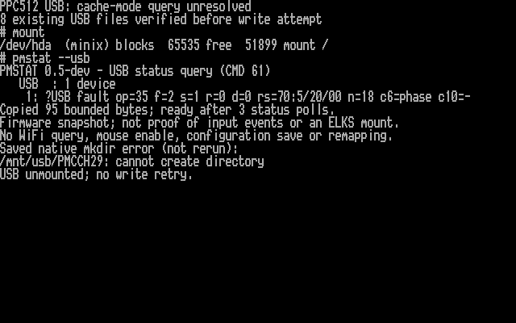

The screenshot comes from actual PPC video memory with live status/mount output
and the explicitly saved native error. I did not retry the write. The guard
returned before sector-write submission, inferred from the firmware control flow
and cached result rather than a physical USB trace. USB unmounted successfully;
SD stayed unmounted and ELKS remains running. Initial stack use was 1736/4096
firmware bytes and 426/700 kernel bytes, with zero flags/invalid counts. Fault-path
peak use was not measured.

The next diagnostic should expose the first transport stage/event/length/status
without adding USB commands or changing write safeguards. The [transport-detail follow-up](#transport-detail-candidate) has now captured the mismatch described below. No cache-setting change or synchronization bypass was made.
[Full hardware evidence](validation/usb-cache-mode-20261029.json).


## Transport-detail candidate

I added a firmware-only record of the cache query's transfer stage, event,
endpoints, byte counts and available CSW checks. It distinguishes a genuine device
phase error from a synthetic checked-transport failure. The original fault remains
visible; `pmstat --usb` adds three bounded cached lines. Reading them sends no new
USB commands. The existing ELKS kernel and utility are sufficient.

This changes diagnostics only. The command sequence, transfer acceptance checks,
write quarantine and cache-flush requirement remain unchanged. Cache state is
still unknown and the read/write release is blocked. The hardware test below captured the mismatch without changing write safeguards.

Validation passes: 18,430 real TinyUSB cases, 151 adapter scenarios, five FAT32
scenarios, 14 legacy USB tests, 29 ELKS status-parser cases, ARM builds and
stack-layout checks. The feature-disabled firmware is byte-identical. The physical check below used a fresh verified recovery backup, read-only checks of the
eight retained files and one guarded write attempt to capture the failure detail.

[Design and field meanings](https://github.com/l00nix/ISA-PicoMEM/blob/codex/usb-sync-lifetime/USB-TRANSPORT-DETAIL.md)
· [Candidate manifest](validation/usb-transport-detail-20261029.json).


## Transport-detail PPC512 result

The full recovery backup and firmware readback passed. ELKS booted with the
existing kernel, USB appeared immediately, and all eight retained files passed
full-content verification through a read-only mount. After unmounting and mounting
explicitly read/write, one fresh `mkdir /mnt/usb/PMTRN29` failed with exit 1.
The cached result was:

```text
?USB fault op=35 f=2 s=1 r=0 d=0 rs=70:5/20/00 n=18 c6=phase c10=-
USB fault op=1a tag=427 why=8 stage=3 event=0
USB xfer ep=81/81 got=13 want=13 data=4
USB CSW checks=1f status=0 residue=0
```

The first cache query failed the **DATA/residue agreement check**. TinyUSB recorded
four DATA bytes for the 64-byte allocation, followed by a successful 13-byte CSW
transfer on the expected endpoint. The raw CSW had a valid signature, matching
tag, bounded residue and status 0, but residue 0 claims all 64 requested bytes
were relevant. The agreement bit `20` is missing from `checks=1f`. The checked
transport then generated synthetic status 2; the device CSW itself did not report
a phase error. MODE SENSE(10) was correctly skipped under the existing policy.

For Data-In, the [USB Bulk-Only Transport specification, section 5.2](https://www.usb.org/sites/default/files/usbmassbulk_10.pdf)
defines residue from the requested length and relevant bytes returned. The observed
counts therefore do not establish a trustworthy cache-page response. This is
firmware-observed evidence, not a physical bus trace: a device reporting an
incorrect residue is one possibility, but a host byte-count problem is not ruled
out. The four raw mode bytes were not captured, so I cannot yet call this an empty
mode header or infer the write-cache setting. **Cache state remains unknown.**

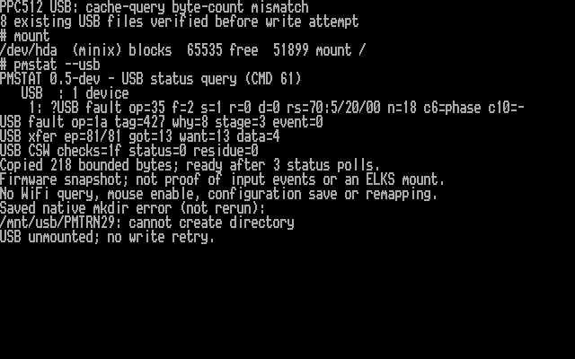

The screenshot comes from actual PPC B800 video memory with live mount/status
output and the explicitly saved native mkdir error. I did not repeat the write.
The pre-write guard returned before sector-write submission, inferred from the
control flow and original `dirty=0` fault rather than a USB trace. USB unmounted
successfully; SD stayed unmounted. Initial stack use was 1632/4096 firmware bytes
and 418/700 kernel bytes with zero flags/invalid counts. Fault-path peak use was
not measured. ELKS remains running with the fault latched until PicoMEM restarts.

This result motivated a bounded capture of returned mode bytes and
MODE SENSE(10) as the **first** cache query on a fresh boot. The follow-up result
is recorded below or in the linked report. Strict transport checks, write quarantine
and the flush requirement remain; no cache-setting change or write retry was made.

[Full hardware evidence and hashes](validation/usb-transport-detail-20261029.json).


## MODE SENSE(10)-first candidate

I built a firmware-only follow-up that starts with MODE SENSE(10) and preserves
up to 16 bytes from an accepted cache-query DATA transfer. A checked completion
with no usable cache page may permit one MODE SENSE(6) alternate; ambiguous
transport still stops the sequence. No residue override, write retry, cache-setting
change or synchronization bypass is included.

`pmstat --usb` reports the latest completed query and a bounded hexadecimal prefix.
The existing ELKS kernel and utilities are sufficient. Even a valid cache-disabled
reply leaves writes blocked in this diagnostic build.

The candidate passes 19,222 transport cases, 153 adapter scenarios, five FAT32
scenarios, 14 legacy USB tests, 30 ELKS status-parser scenarios, ARM builds and
stack-layout checks. The feature-disabled firmware is byte-identical. Hardware
validation is complete; the PPC is running this firmware. See the result below.

[Design, output fields and hardware test plan](https://github.com/l00nix/ISA-PicoMEM/blob/codex/usb-sync-lifetime/USB-MODE10-PREFIX.md)
· [Candidate manifest](validation/usb-mode10-prefix-20261029.json).


## MODE SENSE(10)-first PPC512 result

I flashed the candidate after a fresh full recovery backup; both backup and new
firmware passed readback verification. USB was detected without reconnecting, and
all eight retained files passed full-content checks through a read-only mount.
After confirming `PMMD1029` was absent, I remounted read/write and made exactly
one `mkdir /mnt/usb/PMMD1029` attempt. It returned exit 1 and
`/mnt/usb/PMMD1029: cannot create directory`. I did not retry.

```text
?USB fault op=35 f=2 s=1 r=0 d=0 rs=70:5/20/00 n=18 c6=- c10=phase
USB query op=5a tag=427 why=8 stage=3 event=0
USB xfer ep=81/81 got=13 want=13 data=8
USB CSW ck=1f s=0 r=0 n=8 b=0006000000000000
```

The captured eight bytes form a MODE SENSE(10) header: length field 6 means eight
bytes including that field, with no block descriptors or mode pages. There is no
caching page and no WCE bit. **Cache state remains unknown.** The host recorded
eight DATA bytes for a 64-byte allocation, then a successful 13-byte CSW transfer
with status 0 and residue 0. The checked transport rejected that count mismatch
and synthesized a phase error; the device did not report status 2. MODE SENSE(6)
was skipped. A device residue quirk or host counting issue still needs independent
verification; this is not a USB bus trace.

No sector write was submitted according to the pre-write guard control flow and
`dirty=0` evidence. Initial stack use was 1632/4096 firmware bytes and 418/700
kernel bytes, with zero flags/invalid counts. After the fault, `pmperf /mnt/usb`
returned exit 1, `pmperf ioctl: I/O error`; the fault-path peak remains unavailable.
USB unmounted successfully; SD stayed unmounted. ELKS remains running with the
fault latched until PicoMEM restarts.

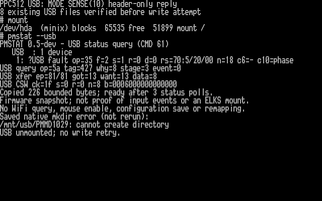

The screenshot is rendered from actual PPC B800 video memory. Mount and cached
status output are live; the saved native mkdir error is explicitly labelled and
was not rerun. The installed firmware is source `ef16c87` / UF2 SHA-256
`48b56652948bacb28ce6988cbdc07799e189de8b9aa04dfbff6bd2752c5cd4b7`.

## Next compatibility work (not implemented)

I will design and host-test bounded short MODE SENSE reply handling, preserving
actual received length and raw CSW evidence while keeping exact sector-transfer
checks. Linux USB storage combines actual transfer residue with the bounded CSW
residue instead of demanding exact agreement; a successful command can have a
short reply. This is a useful implementation reference, not proof of this drive's
persistence behavior. [Linux transport source](https://github.com/torvalds/linux/blob/d89e1d186ec9271bf78e62771779e9fc03bf0fc3/drivers/usb/storage/transport.c#L1195-L1229).

Write policy needs a separate decision: distinguish successful cache flush,
reported cache-disabled operation, and unknown cache state. Linux's disk driver
uses explicit defaults when a caching page is absent, including an assumed
write-through mode unless configured otherwise. An assumption must remain visible;
it cannot be presented as a device-reported WCE=0. I have not enabled that fallback
or relaxed the current write guard. Independent device comparison and persistence
tests remain necessary before a RW release. [Linux cache defaults](https://github.com/torvalds/linux/blob/d89e1d186ec9271bf78e62771779e9fc03bf0fc3/drivers/scsi/sd.c#L3071-L3082).

[Hardware evidence, file hashes and firmware manifest](validation/usb-mode10-prefix-20261029.json).


## Bounded short MODE SENSE candidate

I built a follow-up that accepts independently bounded actual DATA and residue
counts for successful exact MODE SENSE cache queries. The parser consumes only
`min(actual DATA bytes, 64 - residue)` and requires the matching terminal record.
Raw counts remain visible; a header without a caching page remains unknown.
Sector transfers, REQUEST SENSE and write quarantine are unchanged.

The candidate passes 19,256 actual TinyUSB cases, 191 adapter scenarios, five
FatFs/FAT32 tests, 14 legacy USB tests and ARM/stack-layout checks. Feature-off
firmware is unchanged. It has now been flashed and tested with the Kingston; the existing kernel is sufficient.

I will compare the Kingston 1 GB FAT32 with a SanDisk Cruzer Mini 512 MB FAT32,
preserving existing files and using a fresh test directory. Each test starts with
read-only checks and a clean MCU session after any fault. A rejected write ends
that session's write test. A drive that accepts flush can proceed to byte-for-byte
write/readback, remount, Mac FAT validation and power-cycle persistence checks.
The two-drive results are recorded below; SanDisk's cache setting remains unknown.

[Implementation, safeguards and test plan](https://github.com/l00nix/ISA-PicoMEM/blob/codex/usb-sync-lifetime/USB-SHORT-MODE.md)
· [Candidate manifest](validation/usb-short-mode-20261029.json).

## Kingston short-reply hardware result

I flashed source `8aa9046` after a verified full recovery backup. The new firmware
passed readback verification, and all eight retained files passed full-content
checks through a read-only mount. One guarded `mkdir /mnt/usb/PMSH1029` returned
exit 1 with `cannot create directory`; I did not retry.

```text
?USB fault op=35 f=2 s=1 r=0 d=0 rs=70:5/20/00 n=18 c6=page c10=page
USB query op=1a tag=428 why=0 stage=3 event=0
USB xfer ep=81/81 got=13 want=13 data=4
USB CSW ck=1f s=0 r=0 n=4 b=03000000
```

Both cache queries completed and parsed as missing caching page. The latest
MODE SENSE(6) reply is a four-byte header, `03 00 00 00`. Its zero residue still
disagrees with the actual count, but the bounded short-reply path now handles it
without inventing a phase error or parsing beyond received bytes. The MODE10
classification is retained as `page`; its raw report was replaced by the latest
query, so this run does not independently retain its exact bytes.

**The Kingston's write-cache state remains unknown and writes remain blocked.**
The unsupported initial flush fault remains visible. No sector write was submitted
according to the pre-write guard and `dirty=0`, rather than a physical bus trace.
Initial measured stack usage was 2052/4096 firmware bytes and 418/700 kernel bytes,
with zero flags/invalid counts. Fault-path peak remains unmeasured. USB unmounted
successfully; SD stayed unmounted.

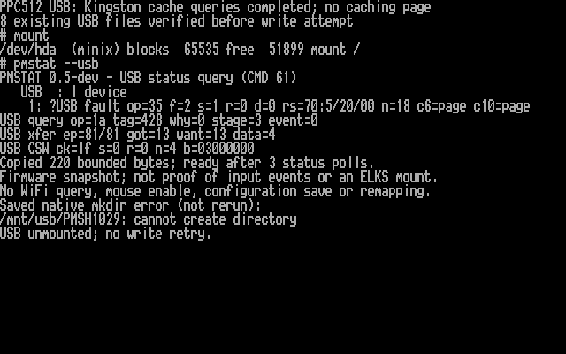

This screenshot is rendered from actual PPC video memory, with live cached status
and mount output. The saved native mkdir error is explicitly labelled and was not
rerun. The completed SanDisk comparison is recorded below.

[Hardware evidence and hashes](validation/usb-short-mode-20261029.json).

## SanDisk comparison result

I tested a second drive, reported as a SanDisk Cruzer Mini 512 MB FAT32. After
booting without a USB stick and inserting it once ELKS was running, PicoMEM
reported a fresh checked-I/O mount with no previous fault. The read-only mount
and directory listing passed. I fully read three existing package files (8,660,
8,720 and 35,508 bytes), saved local copies and recorded their checksums. These
are pre-test baselines, not independent content verification or post-test checks.
I have not published the unrelated personal filenames from the directory listing.

After confirming `PMSD1029` did not exist, I remounted read/write and made one
`mkdir /mnt/usb/PMSD1029` attempt. It failed with exit 1 and `cannot create directory`:

```text
?USB fault op=35 f=6 s=255 r=0 d=0
```

`op=35` is SYNCHRONIZE CACHE(10); `f=6` is the adapter's two-second timeout.
`s=255` is a sentinel, not a status returned by the drive. There was no validated
failed CSW, so REQUEST SENSE and MODE SENSE were not submitted. This does not
establish that SanDisk rejects the opcode or has its cache enabled/disabled.
The precise transport stage and cause of the timeout remain unknown.

No sector write was submitted according to the pre-write guard and `dirty=0`
evidence; this is not a physical bus trace. I did not retry. USB unmounted
successfully, SD stayed unmounted, and ELKS is left running with the fault latched.
Initial stack usage was 2136/4096 firmware bytes and 426/700 kernel bytes, with
zero flags/invalid counts. Fault-path peak remains unmeasured.

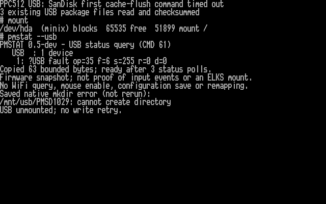

The screenshot uses actual PPC video memory, live mount/status output and the
explicitly saved native error, without repeating the write.

| Drive | Read-only checks | Initial cache flush | Cache-page queries | Write outcome |
| --- | --- | --- | --- | --- |
| Kingston DataTraveler 1 GB | Eight retained files verified | Valid failure; sense 5/20/00 | Both completed, no caching page | Blocked before sector write |
| SanDisk Cruzer Mini 512 MB | Listing and three file baselines read | Adapter timeout; no validated CSW | Not run | Blocked before sector write |

The second drive exposed a separate timeout path; it does not validate a RW
release. Next I need bounded evidence of the flush transport stage at timeout,
then host tests for any required recovery, alongside an explicit policy for
unsupported flush with unknown cache state. Extending the timeout or bypassing
flush without that evidence is not an established fix.

The user also reported the PPC display-switch shortcut working again after a
boot without the SanDisk. Its behavior after hot-plugging the drive was not
checked. This remains an observation to investigate, not proof of a firmware,
keyboard, power or USB-device cause. No screen-control code changed in this test.

[Two-drive evidence and hashes](validation/usb-short-mode-20261029.json).


## Pending transfer diagnostic candidate

I added a diagnostic candidate for the SanDisk's initial flush timeout. It records
which USB stage is pending, whether the host driver accepted the transfer, and
the last completion callback at the existing deadline. The existing `pmstat --usb`
can display the cached evidence. No new ELKS kernel is needed.

Host sanitizer tests, disposable FAT32 tests, ARM build and stack-layout checks
pass; the feature-disabled firmware remains byte-identical to the baseline.
**The hardware result below locates the pending status transfer; read/write release remains blocked.** The
candidate preserves the existing write safeguards and does not add retries or
USB resets. I will first test SanDisk after booting ELKS without the stick and
inserting it at login, preserving all existing files.

[Implementation and hardware test plan](https://github.com/l00nix/ISA-PicoMEM/blob/codex/usb-sync-lifetime/USB-TIMEOUT-STAGE.md)
· [Validation manifest](validation/usb-timeout-stage-20261029.json).


## SanDisk pending status result

The 30 October PPC512 test matched all three saved file checksums through a
read-only mount. One guarded directory-creation attempt then timed out. The new
snapshot shows a successful 31-byte command-wrapper completion, followed by an
accepted 13-byte status IN transfer with no completion callback by the two-second
deadline. No sector write was submitted according to the guard and dirty flag.
The exact cause remains unresolved; this does not prove an unsupported command.

I saved the evidence, unmounted USB and left ELKS running. No write retry was made.
The next investigation is the host-controller status-transfer/completion path.
[Full result and interpretation](https://github.com/l00nix/ISA-PicoMEM/blob/codex/usb-sync-lifetime/USB-TIMEOUT-STAGE.md#ppc512-result--30-october-2026).

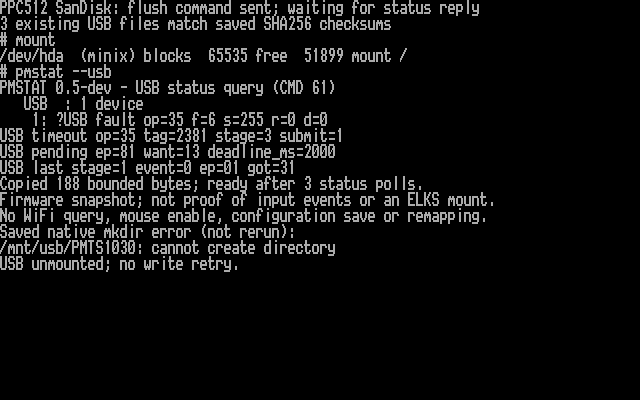

This is actual PPC text-video memory rendered with its BIOS font. The mount and
status output are live; the saved native mkdir error is explicitly marked and
was not rerun for the screenshot.


## Native controller diagnostic candidate

I added a read-only snapshot of the RP2350 USB controller to investigate the
SanDisk's pending status reply. It records endpoint buffer/control flags, polling
state, completion/interrupt bits and software transfer state, with frame samples
from submission and timeout. The existing `pmstat --usb` can display the evidence.

Host sanitizer tests, mock-register tests, FAT32 image tests, ARM build and stack
layout checks pass. **The hardware snapshot below captured a pending receive;
read/write release remains blocked.** No new ELKS kernel is needed. This candidate does not change the
timeout, send extra USB commands, retry, reset or bypass write safeguards.

[Implementation, field meanings and limitations](https://github.com/l00nix/ISA-PicoMEM/blob/codex/usb-sync-lifetime/USB-HOST-STATE.md)
· [Validation manifest](validation/usb-host-state-20261030.json).


## SanDisk controller-state result

The 30 October PPC512 run matched all three saved file checksums, then one guarded
mkdir failed. At timeout, the status receive buffer was still available for 13
bytes, its endpoint/polling slot enabled, and software marked the transfer active.
USB frame samples advanced by 1999 modulo 2048. No current STALL flag, buffer
completion or masked interrupt was present.

This points toward a still-pending status receive. The global NAK flag is latched
and is not proof of repeated NAKs on this command. I made no retry, unmounted USB,
and left ELKS running. The next proposed experiment is a separate bounded window
observing late completion while retaining the normal timeout and write quarantine.
[Full interpretation and limitations](https://github.com/l00nix/ISA-PicoMEM/blob/codex/usb-sync-lifetime/USB-HOST-STATE.md#ppc512-controller-result--30-october-2026).

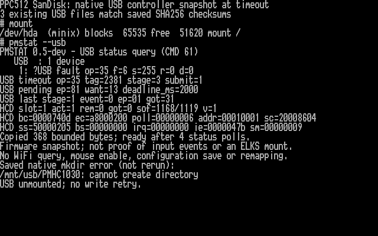

The screenshot is actual PPC text-video memory rendered with its BIOS font. Status
and mount output are live; the saved native error is labelled and was not rerun.


## Late status observation candidate

I added a bounded observer for the initial clean flush timeout. The file-service
operation still fails after two seconds and writes stay blocked. The normal USB
task watches the already-outstanding transfer for 30 additional seconds, recording
a checked late reply, invalid callback, disconnect or no observation before expiry.
It does not retry, reset or send another USB command, and even late success cannot
enable writes. The original controller snapshot remains frozen.

The build and sanitizer/FAT32 tests pass, including 43 dedicated observation cases.
**The hardware test below recorded no late completion.** Existing ELKS and `pmstat --usb` display the result.
[Behavior, suffix fields and limitations](https://github.com/l00nix/ISA-PicoMEM/blob/codex/usb-sync-lifetime/USB-LATE-STATUS.md)
· [Validation manifest](validation/usb-late-status-20261030.json).


## SanDisk late-status result

The PPC512 run on 30 October matched all three saved SanDisk file checksums.
One guarded mkdir failed at the normal two-second flush timeout. The observer
then changed from `obs=wait` to `obs=none os=255 why=0 ms=30000`: no completion
or detach was recorded during the additional 30-second window. The original six
controller/timeout lines stayed unchanged.

This measures software callback delivery, not physical bus traffic. It does not
identify whether the drive failed to respond or the host failed to deliver a
completion. The frozen controller data is from the initial timeout, not expiry.
I made no retry, unmounted USB and left ELKS running with writes blocked. The
next investigation is the native controller status-transfer path and a controlled
comparison. No new kernel was needed, and the upstream draft PR is unchanged.

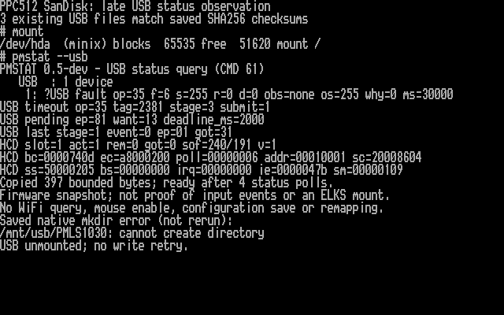

This is actual PPC text-video memory rendered with its BIOS font. Mount and
status output are live; the saved native mkdir error is labelled and was not rerun.


## Powered hub comparison

On 30 October I checked both sticks through a powered USB hub. PicoMEM counted
two non-hub devices when both were attached, but the file service exposes only
one storage volume. I identified the selected SanDisk by a saved full-file
checksum, then removed both sticks and reconnected only the Kingston. All eight
saved Kingston file checksums matched, including long names and nested paths.

With only the Kingston connected, I confirmed a fresh `PMHK1030` name was absent
and made one guarded mkdir attempt. It failed with the same unsupported-flush
response seen in the earlier direct-connected Kingston run:

```text
op=35 f=2 s=1 r=0 d=0 rs=70:5/20/00 n=18 c6=page c10=page
```

The drive rejected SYNCHRONIZE CACHE(10), and neither MODE query provided a usable
caching page. The latest MODE6 response was the four-byte header `03000000`.
The 30-second observer does not apply here: this was a completed command-failed
response, not a timeout. The hub did not resolve this Kingston write blocker.
This does not establish the cause of the SanDisk's different timeout failure.
The earlier direct Kingston test used the short-mode diagnostic firmware; I have
not performed a same-firmware direct/hub A/B comparison.

I made no write retry, unmounted USB and left ELKS running. The guard and `d=0`
indicate no sector write was submitted; this is a software inference rather than
a physical USB trace. There was no post-fault media readback. A separate fresh
PicoMEM session is needed to compare the SanDisk's flush behavior through the hub.

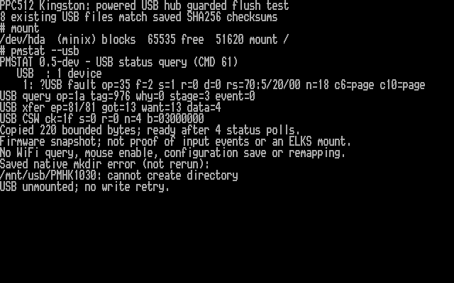

The screenshot is actual PPC text-video memory rendered with its BIOS font.
Mount and status output are live; the saved mkdir error is labelled and was not
rerun. [Validation record](validation/usb-powered-hub-20261030.json).


## Hub and multiple-device inventory candidate

I added explicit hub and downstream-device rows to `pmstat --usb`. The candidate
shows cached vendor/product IDs, hub ports and whether a disk is selected,
inactive or blocked. It uses the existing utility and kernel, with no extra USB
transfer or change to storage selection. The configured limit remains one hub
and four downstream devices, with one storage volume exposed at a time.

During a fault, the report keeps hub counts but prioritizes existing fault and
transport diagnostics over hub detail rows. Builds, sanitizer tests and the
existing ELKS status-reader tests pass. **The one-hub/two-disk hardware test below
also passed.** This reporting change does not resolve the cache-flush blocker or
enable writes.

[Behavior, examples and bounds](https://github.com/l00nix/ISA-PicoMEM/blob/codex/usb-sync-lifetime/USB-INVENTORY.md)
· [Validation manifest](validation/usb-inventory-20261030.json).


## Hub inventory hardware result

The PPC512 now reports the powered hub (`1a40:0101`) at USB address 5, the selected
Kingston (`0951:1602`) at address 1 on hub port 4, and the inactive SanDisk
(`0781:5150`) at address 2 on hub port 3. The SanDisk was added while ELKS was
running; Kingston remained selected. All eight saved Kingston file checksums
matched through a read-only mount with both disks connected.

I safely unmounted USB and left ELKS running. No write was attempted, and no USB
fault was reported. Only one storage volume is exposed; `inactive` does not mean
a second ELKS mount exists. The first query already showed the hub and Kingston,
so the empty-inventory hardware case was not observed.

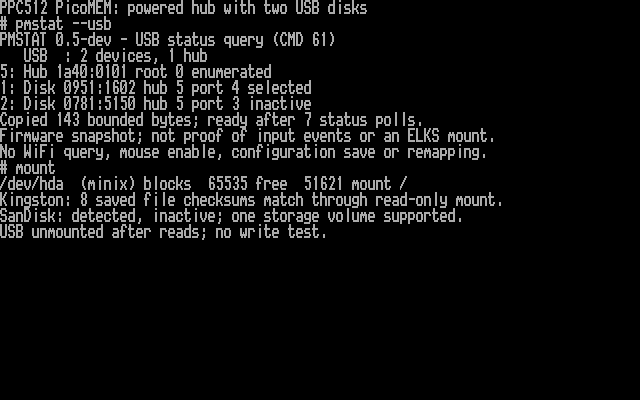

This is actual PPC text-video memory rendered with its BIOS font. Status and
mount output are live; the checksum summary comes from verified full-file reads.
[Hardware evidence](validation/usb-inventory-20261030.json).


## SanDisk powered-hub flush result

On 30 October I tested the SanDisk alone through the powered hub, using the
inventory firmware. It appeared as `0781:5150`, selected on hub address 5, port 3.
All three saved full-file checksums matched through a read-only mount. The
firmware session had no prior write attempt or fault; clean removal of the
Kingston and reattachment selected the SanDisk.

After confirming `PMHS1030` was absent, one guarded mkdir failed. The command's
31-byte OUT wrapper completed, but its 13-byte status IN had no completion by the
two-second deadline. The observer changed from `obs=wait` to:

```text
op=35 f=6 s=255 r=0 d=0 obs=none os=255 why=0 ms=30000
```

All six original timeout/controller lines remained unchanged. The hub did not
resolve the timeout: no completion or detach was recorded during the extra
30-second window. This is software evidence, not a physical USB trace, and does
not establish whether the drive or controller path is responsible. The earlier
direct-connected test used the late-observer firmware; this version adds
inventory reporting, so this is not a same-firmware A/B comparison.

The fault display retained the hub count and all six diagnostic lines by omitting
the hub detail row, as designed. I made no write retry, safely unmounted USB, and
left ELKS running. The fault stays latched until PicoMEM restarts. The audited guard and `d=0` indicate that no sector write was submitted;
no post-fault media readback was
attempted. A third drive comparison, if available, needs a fresh MCU session.

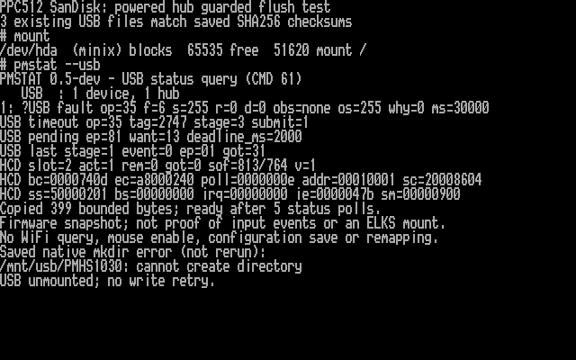

This is actual PPC text-video memory rendered with its BIOS font. Mount and status
output are live; the saved native mkdir error is labelled and was not rerun.
[Full hardware record](validation/usb-sandisk-hub-20261030.json).


## Generic drive powered-hub result

On 30 October I tested a third drive, reported as a generic 256 MB flash disk
(`0011:7788`). The Mac identified a 256 MiB FAT32 partition on a device reporting
about 1 GB total capacity. Its read-only FAT check passed, and all 104 files were
readable. I did not format or repair it.

Before the Mac round trip, PicoMEM listed this drive as inactive and ELKS could
not mount it. After reconnection alone through the powered hub, it was selected
at address 1, hub 5 port 3. ELKS mounted it read-only and displayed long names.
All nine non-hidden files matched the Mac's whole-file SHA256 checksums. This
successful reconnection does not establish the cause of the earlier mount failure.

After confirming `PMGH1030` was absent, one guarded mkdir failed:

```text
op=35 f=2 s=1 r=0 d=0 rs=70:5/26/00 n=18
```

The flush returned a failed status and REQUEST SENSE returned `05/26/00`:
[INVALID FIELD IN PARAMETER LIST](https://www.t10.org/lists/asc-num.htm).
This differs from Kingston's unsupported-opcode response and SanDisk's timeout.
It does not establish that the request is malformed or that flushing is unsupported.
The current cache-mode diagnostic runs only after `05/20/00`, so it did not run
for this response. Cache policy remains unknown.

The audited pre-write guard and `d=0` indicate that no sector write was submitted;
this is software evidence, not a physical bus trace. I made no retry, safely
unmounted USB, and left ELKS running. No post-fault media readback was attempted.
The fault remains latched until PicoMEM restarts. The next investigation is a
review of the flush request and transport against a reference implementation,
with the write safeguards retained.

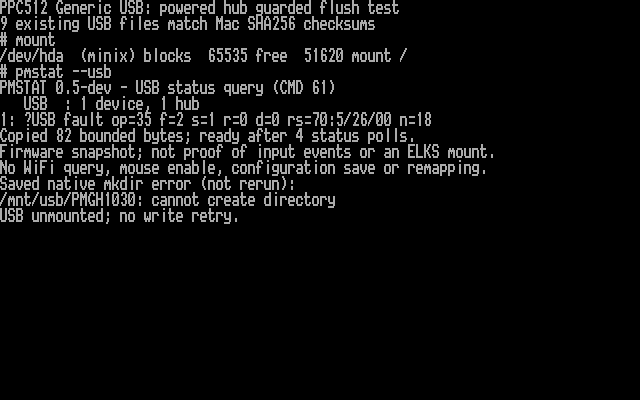

This is actual PPC text-video memory rendered with its BIOS font. Mount and status
output are live; the saved mkdir error is labelled and was not rerun. The checksum
summary comes from verified whole-file reads.
[Hardware record](validation/usb-generic-hub-20261030.json).


## Command audit and cache-policy next step

I reviewed the flush CDB, wrapper fields and command-to-status transition against
USB BOT 1.0 and Linux v6.12. I found no encoding defect in that review. All 72 new
tests joining the actual PicoMEM adapter and patched TinyUSB MSC implementation
passed, as did the existing suites. The controller completions are modelled;
these tests do not establish what happens on the physical bus.

The candidate's policy is stricter than desktop Linux: it requires a successful
flush before any sector write. Linux can fall back to assuming write-through
when cache information is unavailable. I have not adopted that assumption for
these drives. The next step is a read-only cache-capability probe before the
first flush, with explicit enabled/disabled/unknown results. Unknown cache policy
must not silently enable writes. No firmware or kernel changed during this audit,
and no new flash is needed for it.

[Audit, references, test coverage and limitations](https://github.com/l00nix/ISA-PicoMEM/blob/codex/usb-sync-lifetime/USB-COMMAND-AUDIT.md).


## Read-only cache-capability candidate

I built a firmware-only diagnostic that probes the current cache settings before
any flush. The first valid attempted USB sector write runs MODE SENSE(10), with
at most one MODE SENSE(6) alternative after a validated completion. The attempt
always fails: this candidate sends no flush or sector-write command and does not
enable writes for any cache result.

The existing `pmstat --usb` displays enabled, disabled or unknown WCE, bounded
reply bytes and I/O state. Status reads are cached. No ELKS kernel or utility
update is needed. A transport fault keeps USB I/O blocked until PicoMEM restarts.
The candidate passed 64 new sanitizer scenarios, four real FAT32 scenarios with
unchanged whole-image hashes, the existing test suites, both ARM builds and stack
layout checks. **Physical validation is pending.**

[Behavior, candidate hashes and planned hardware test](https://github.com/l00nix/ISA-PicoMEM/blob/codex/usb-sync-lifetime/USB-CACHE-PROBE.md).
