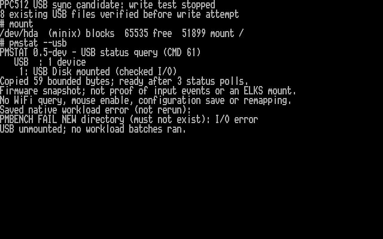
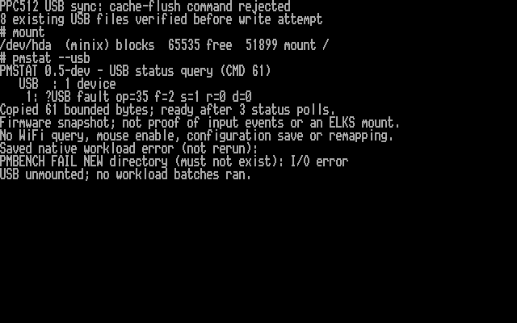
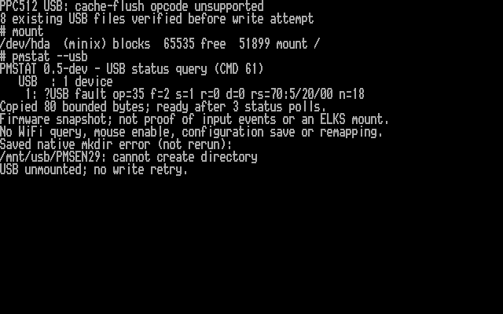

# USB cache flush and timeout containment candidate

I have prepared the next firmware-only step toward reliable PicoMEM USB writes.
**REQUEST SENSE confirms the Kingston rejects the cache-flush opcode. Read checks pass; writes remain blocked pending cache-mode investigation.**
The existing diagnostics kernel and utilities are sufficient. SD remains read-only.

The preceding [file-service error milestone](FILE-SERVICE-ERRORS.md) reports
failures, but its USB timeout could leave the controller pointing at a caller's
old buffer. This candidate gives USB a permanently allocated 512-byte buffer.
After an uncertain operation, it stops USB I/O until PicoMEM restarts and keeps
that buffer reserved, including when a completion arrives late. It also checks
USB transfer lengths, completion status and command identity more strictly.

Filesystem synchronization now sends a real device-cache flush command. Before
the first sector write, the firmware tests whether the drive supports that flush.
Unsupported or failed flushes stop the operation; a failed close cannot silently
report success. This does not prove protection against power loss or provide
transactional writes. The Kingston returned command-failed status for the flush; the later sense diagnostic below identifies an invalid command opcode.

The candidate is default-off on `codex/usb-sync-lifetime`. See the
[firmware design, build instructions and test plan](https://github.com/l00nix/ISA-PicoMEM/blob/codex/usb-sync-lifetime/USB-SYNC-LIFETIME.md)
and [artifact/test manifest](https://github.com/l00nix/ISA-PicoMEM/blob/codex/usb-sync-lifetime/USB-SYNC-LIFETIME.json).

Local validation covers 578 cases in the actual TinyUSB state machine, 56 adapter
scenarios with memory-error sanitizers, five real FAT32/mount scenarios, and the
existing LFN/create/rename/diagnostic/error regressions. A normal long-name file
was independently read with mtools; a simulated unsupported flush caused zero
sector writes. Firmware RAM use increases by 512 bytes, with the 4 KiB stack
reservation intact. Runtime stack usage and the performance cost of one-sector
transfers still need hardware measurements.

The diagnostic follow-up has now captured the failed command through
`pmstat --usb`. The next step is a bounded read-only REQUEST SENSE diagnostic
to obtain the detailed reason; that follow-up is not implemented yet. Writes
stay blocked. After a validated fix, the bounded workload, clean remount,
independent Mac checks, ELKS return trip and DOS compatibility remain required. No
real-media failure injection is planned. The upstream metadata-only draft PR
remains unchanged.

This candidate provides safe buffer containment on timeout. Automatic USB
controller cancellation/reset recovery remains unfinished; restarting the PC
alone is not assumed to restart PicoMEM.

## First PPC512 attempt

The full-flash recovery backup and firmware readback passed. ELKS booted; after
reconnecting the Kingston, PicoMEM detected it. All eight existing USB files
matched their expected contents through a read-only mount. The initial detection
miss has not been explained.

The first directory creation in `PMSYNC29` returned **I/O error**, before any
workload batches ran. The file-service session then also refused the diagnostic
ioctl. I stopped writes and successfully unmounted USB. SD stayed unmounted.
There is no evidence yet identifying the failed USB command or proving that no
sector changed. The new flush probe is a possible cause, not a diagnosis.



This is actual PPC text video memory rendered with its BIOS font. It shows live
`mount` and `pmstat` output, the explicitly saved native workload error (not a
second attempt), and a summary of the verified checks. PicoMEM's cached USB
status describes its internal device state; the ELKS `mount` listing confirms
that USB is unmounted.

[Detailed first-attempt evidence](validation/usb-sync-first-write-20261029.json).
The diagnostic follow-up's host tests/build pass, including 59 adapter scenarios.
Its physical result follows below. The read/write release is still blocked.

## Diagnostic PPC512 result

The diagnostic firmware was backed up, flashed and readback-verified. The Kingston
was detected immediately, and all eight existing files again matched their full
contents through a read-only mount. The first directory creation in fresh
`PMSYD29` failed, with this cached status:

```text
?USB fault op=35 f=2 s=1 r=0 d=0
```

`35` is SYNCHRONIZE CACHE(10); `f=2 s=1` identifies a validated command-failed
response. The pre-write probe returned before any sector WRITE was submitted
by this attempt, based on the firmware control flow and the clear dirty flag.
No physical USB trace was taken. There were no retries and no workload batches.
USB is unmounted, SD stayed unmounted, and ELKS remains running.



The screen is rendered from actual PPC video memory. The native workload error
is explicitly saved output, not another write attempt. The full
[artifact hashes, file checks, fault fields and capture provenance](validation/usb-sync-fault-status-20261029.json)
are recorded.

This confirms the failing command, but not why the drive rejected it. Under the
[USB BOT specification](https://www.usb.org/sites/default/files/usbmassbulk_10.pdf),
status 1 means command failure. Detailed SCSI sense data is needed before calling
it an unsupported opcode or deciding on compatibility behavior. I will keep the
write guard in place while investigating; a failed flush must not silently become
success. The follow-up below has now captured the detailed sense response.


## REQUEST SENSE diagnostic

I added one bounded read-only query after the initial, fully validated clean flush
failure. It preserves the original fault and keeps writes blocked. It uses its own
persistent USB request/data storage and a two-second timeout; failed or ambiguous
transport never triggers the query. Short sense replies are accepted only with
matching transfer length and residue, and complete required header fields.

`pmstat --usb` appends `rs=FORMAT:KEY/ASC/ASCQ n=BYTES`, or an explicit reason
why sense data could not be trusted. No new ELKS kernel or utility is needed.
The Kingston result is recorded below. An unsupported-flush
sense code alone will not justify silently skipping synchronization.

The candidate passes 983 TinyUSB cases, 89 adapter scenarios, five real FAT32 tests
and 14 legacy USB tests, plus ARM builds and stack-layout checks. The build with
the experiment disabled remains byte-identical. The full-flash backup, firmware readback and hardware sense diagnostic have now
passed. The full read/write release tests remain pending.

[Implementation and hardware plan](https://github.com/l00nix/ISA-PicoMEM/blob/codex/usb-sync-lifetime/USB-SYNC-LIFETIME.md#request-sense-follow-up)
· [Candidate manifest](validation/usb-request-sense-20261029.json).


## REQUEST SENSE PPC512 result

USB was detected immediately after startup. All eight retained files passed
full-content readbacks through a read-only mount. After unmounting and explicitly
mounting read/write, I made one fresh `mkdir /mnt/usb/PMSEN29` attempt. It failed
with exit 1 and `cannot create directory`. The cached status was:

```text
?USB fault op=35 f=2 s=1 r=0 d=0 rs=70:5/20/00 n=18
```

The 18-byte current-format response reports illegal request / invalid command
operation code. This confirms rejection of SYNCHRONIZE CACHE(10); the
[T10 sense-code list](https://www.t10.org/lists/asc-num.txt) assigns 20/00 to that
condition. The pre-write flush guard returned before WRITE(10) submission, based
on the audited firmware control flow and status; no physical USB trace was taken.



The screenshot is rendered from actual PPC video memory, with live mount/status
output and the explicitly saved native error. I did not repeat the failed write.
USB unmounted successfully, SD stayed unmounted, and ELKS remains running. Initial
stack readings were 1624/4096 firmware bytes and 426/700 kernel bytes with zero
flags/invalid counts; fault-path peak usage was not measured.

The next step is a read-only query of current write-cache settings. An unsupported
flush does not prove absence of volatile caching. Missing or unsupported cache
information must remain unknown; no flush bypass or cache-setting change has been
made. [Full hardware evidence and hashes](validation/usb-request-sense-20261029.json).


## Current cache-mode candidate

I added a read-only current caching-page query after the confirmed unsupported
flush response. It tries MODE SENSE(6), with one MODE SENSE(10) alternate only after
a clean completed reply without usable cache information. Each query has its own
persistent storage and two-second deadline. Ambiguous transport stops the sequence.
No cache settings change, no write retry and no synchronization bypass is included.

`pmstat --usb` gains `c6` and `c10` fields. `on`/`off` report the current write-cache
enable bit; all failure, malformed-page or missing-page results remain unknown.
Even an `off` reply does not enable writes in this diagnostic build. The existing
ELKS kernel and utilities are sufficient.

The candidate passes 18,423 transport cases, 150 adapter scenarios, five FAT32
tests, 14 legacy USB tests, ARM builds and stack-layout checks. The disabled build
is byte-identical to its previous artifact. **Hardware testing is pending.**
Next comes a fresh recovery backup and verified flash, read-only file checks,
one fresh `mkdir` trigger, cached status capture and unmount.

[Query design, status meanings and test plan](https://github.com/l00nix/ISA-PicoMEM/blob/codex/usb-sync-lifetime/USB-CACHE-MODE.md)
· [Candidate manifest](validation/usb-cache-mode-20261029.json).
